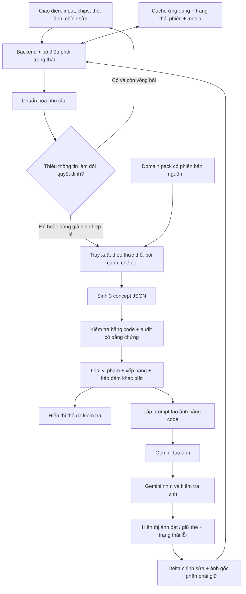

# Kiến trúc tổng quát và quy trình vận hành AI Arena

## 1. Định hướng và phạm vi

Thiết kế phục vụ demo chức năng: hiểu yêu cầu, tư vấn có căn cứ, tạo đầu ra trực quan và cho phép chỉnh sửa. Ưu tiên luồng thông suốt, thời gian phản hồi và khả năng đổi đề. Không xây hệ thống microservice, nhiều agent tự trị, vector database lớn hay bộ kiểm soát bảo mật riêng cho MVP.

Đề Việt phục yêu cầu: chọn trang phục hoặc sự kiện; chọn màu, phụ kiện hoặc phong cách; xem ảnh/thẻ/mockup; đọc thông tin ngắn về nguồn gốc hoặc ý nghĩa. Thử đồ bằng ảnh, thời tiết, so sánh, lookbook và cảnh báo là các phần bổ sung. Vì vậy, **thẻ gợi ý có kiến thức ngắn và tùy chọn chỉnh sửa là đầu ra cốt lõi; tạo ảnh là phần nâng trải nghiệm**.

Phần tổng quát tái dùng gồm: hợp đồng dữ liệu, chuẩn hóa nhu cầu, điều phối lượt gọi, cache, kiểm tra bằng chứng, xếp hạng và phiên bản chỉnh sửa. Phần phải đổi theo đề gồm: loại thực thể, trường cần hỏi, kiến thức, luật theo bối cảnh, recipe, tiêu chí chất lượng và khả năng của giao diện. Trường ảnh, palette hay phụ kiện chỉ thuộc adapter đề trực quan; không bắt các đề giáo dục, du lịch hoặc sự kiện dùng cùng schema trang phục.

## 2. Phản biện phương án ban đầu

**“Cache hoàn hảo” không khả thi và cũng không cần.** Vấn đề là biết hệ thống đang biết gì, thiếu gì, và hành động thế nào khi thiếu. Một pack nhỏ có nguồn, phạm vi và trạng thái xác minh hữu ích hơn một kho lớn do model tự suy diễn.

**Sinh nhiều prompt không bảo đảm nhiều ý tưởng.** Model có thể tạo nhiều bản diễn đạt của cùng một phối đồ. Hãy sinh 3 concept khác nhau theo những trục cụ thể: palette, loại phụ kiện, độ trang trọng hoặc bố cục; giữ các đặc trưng bắt buộc giống nhau. Chỉ mở rộng lên 5 khi kiểm thử cho thấy 3 thường không có phương án đạt.

**Năm auditor dùng cùng model không phải năm chuyên gia độc lập.** Chúng có thể đồng thuận vì cùng thiếu kiến thức. Chất lượng tăng chủ yếu từ nguồn, luật kiểm tra, ngữ cảnh đúng và việc nhìn ảnh thực tế. Chia vai trò để giảm thiên lệch là hữu ích; không cần biến mỗi vai trò thành một API riêng.

**Không đặt vi phạm văn hóa vào một trọng số thấp.** Một phát biểu nguồn gốc sai đã có bằng chứng hoặc một đặc trưng bắt buộc bị mất phải làm phương án thất bại. Ngược lại, “phối như thế này tôi thấy không đẹp” không phải vi phạm văn hóa. Luật chỉ là bắt buộc khi có nguồn/phạm vi áp dụng rõ hoặc là yêu cầu trực tiếp của người dùng.

**Đừng yêu cầu mọi thông tin trước khi bắt đầu.** Thiếu tông màu có thể cho lựa chọn; thiếu thời kỳ khi muốn tái hiện lịch sử thì cần hỏi. Độ quan trọng được xác định theo quyết định và hậu quả, không theo một danh sách dài cố định.

## 3. Kiến trúc tối thiểu



Một ứng dụng full stack, một backend và SQLite hoặc file JSON là đủ cho đội thi nhỏ. Giao diện dùng framework đội đã thành thạo; phía server có `GeminiAdapter`, `Orchestrator`, `PackRepository`, `RuleEngine`, `CacheStore`. MVP dùng bộ lọc tag và tìm văn bản; chưa cần embedding. SSE hoặc polling ngắn đưa trạng thái/thẻ/ảnh về giao diện; không cần streaming JSON chưa được kiểm tra ra màn hình.

Adapter cung cấp ba hàm ứng dụng: `structuredTask(task, context, schema)`, `generateImage(prompt, references)`, `inspectImages(images, rules)`. Đây là hợp đồng nội bộ, không phải tên hàm SDK. Model và các tính năng được chọn qua cấu hình, không hardcode trong prompt.

## 4. Chuẩn bị trước thi và thao tác khi nhận đề

### Trước thi

Chuẩn bị bộ điều phối, UI chọn nhanh, template P00–P08, schema, rubric, cache, màn hình trạng thái và dữ liệu kiểm thử giả lập. Kiểm tra một lượt JSON, một lượt ảnh và một lượt chỉnh ảnh với tài khoản dự định dùng. Ghi model thực tế, quota và SDK đã thử. Chuẩn bị các renderer tổng quát: thẻ, so sánh và ảnh; không thu thập sẵn kho dữ kiện cho một đề phỏng đoán.

### Khi nhận đề

1. Dùng P00 biến đề thành pack nháp: đối tượng, nhu cầu, bắt buộc/bổ sung, phạm vi, đầu ra và chỗ thiếu kiến thức.
2. Đội đọc lại bản nháp; chọn một nhóm người dùng và một hoặc hai tình huống chính. Số lượng là giới hạn triển khai, không phải quy tắc cuộc thi.
3. Nếu cần kiến thức văn hóa, nhập vài đoạn nguồn chính thức hoặc nguồn chuyên môn đội có thể kiểm tra trong thời gian thi. Khoảng 10–20 knowledge unit là mục tiêu cho demo hẹp, không phải mức đủ để bao quát văn hóa.
4. Dùng P01 tách dữ kiện và đề xuất luật; đội xác minh đoạn hỗ trợ, phạm vi thời gian/địa phương, nguồn và cách diễn đạt. Model không được tự đánh dấu nguồn do nó tạo là đã duyệt.
5. Bật một snapshot pack đã kiểm tra. Nếu chưa có nguồn, chạy chế độ đề xuất thiết kế với thông báo thiếu căn cứ và không đưa đoạn lịch sử tưởng tượng vào thẻ.
6. Chạy các ca eval phù hợp; ghi lỗi và sửa pack/template, rồi tăng phiên bản. Đóng băng snapshot cho lần trình diễn.

Có thể chỉ nhập nguồn thủ công; không cần tính năng web search tự động trong demo. Khi không có internet hoặc không tìm được nguồn, hệ thống vẫn tư vấn màu/phong cách dưới dạng đề xuất, nhưng không hứa “chuẩn lịch sử”.

## 5. Domain pack: dữ liệu nào lưu ở đâu?

**Pack là dữ liệu gốc được quản lý; cache là bản tái sử dụng có thể bỏ đi.** Pack gồm các nhóm sau:

- **Brief và yêu cầu:** nhu cầu người dùng mục tiêu, đầu ra bắt buộc, chức năng bổ sung, ràng buộc trình bày. Đề bài là nguồn cho yêu cầu sản phẩm, không phải thẩm quyền để xác nhận mọi dữ kiện văn hóa.
- **Ontology:** các loại entity như trang phục, địa phương, thời kỳ, sự kiện, nhân vật; ID, tên hiển thị, alias, tag, quan hệ và phạm vi. Không chỉ gộp tất cả thành mô tả tự do.
- **Knowledge unit:** một phát biểu có thể trích dẫn, nguồn/đoạn hỗ trợ, entity liên quan, phạm vi, trạng thái `draft|verified|disputed|retired`. Tách `task_fact`, `cultural_fact` và `design_suggestion`.
- **Rules:** điều kiện áp dụng, kiểm tra, mức `hard|soft|advisory`, cơ sở, khả năng quan sát trong ảnh, cách sửa và chế độ áp dụng. Không có bằng chứng thì chưa bật làm luật văn hóa bắt buộc.
- **Recipes:** các cấu trúc đề xuất đã thử: palette, mục tiêu sử dụng, phụ kiện, giới hạn và điểm biến thiên. Recipe là gợi ý, không phải bằng chứng lịch sử.
- **UX config:** trường/chips, default, điều kiện phải hỏi, renderer, tính năng được bật. Thời tiết, avatar, vẽ và lookbook là feature flag, không đưa tất cả vào prompt của mọi bước.
- **Eval và provenance:** case đánh giá, phiên bản pack, người duyệt hoặc quy trình duyệt, hash nguồn và các model/template đã dùng.

Ví dụ knowledge unit thật cần có dạng:

```json
{
  "id": "K-...",
  "kind": "cultural_fact",
  "claim": "Một phát biểu cụ thể được nguồn hỗ trợ",
  "source_id": "S-...",
  "source_excerpt": "Đoạn liên quan đã kiểm tra",
  "scope": {"entity_ids": ["..."], "region": null, "period": null},
  "status": "draft",
  "verification_note": null
}
```

Đây là hình dạng dữ liệu, không phải một dữ kiện văn hóa để sử dụng. Trong file mẫu, các tên trang phục chỉ được lấy từ đề; chưa điền mô tả lịch sử hay đặc trưng tạo hình chưa có nguồn.

**Phát biểu mâu thuẫn:** giữ cả hai nguồn và phạm vi; nếu có thể giải thích bằng thời kỳ/địa phương thì thu hẹp phát biểu. Nếu chưa giải quyết được thì đánh dấu `disputed`, không coi một nguồn thắng chỉ vì model tự chấm độ tin cậy cao hơn.

**Nhu cầu người dùng không nằm trong knowledge pack.** Nhu cầu đang xử lý ở `session.brief`; nhu cầu lặp lại có thể trở thành recipe sau khi đội xem xét. Thông tin người dùng nói được gắn `user_provided`, không tự thành kiến thức văn hóa.

## 6. Các lớp cache và quy tắc vô hiệu hóa

### C0 — Pack và template

Snapshot JSON bất biến theo `pack_id + pack_version + content_hash`. Đây là kho dữ liệu gốc. Chỉ bật knowledge/rule đã duyệt. Truy xuất dựa trên entity, sự kiện, mode và các điều kiện applicability; luôn nạp mọi luật bắt buộc áp dụng, rồi mới cắt top-k dữ kiện/gợi ý. Không để top-k làm rơi một luật quan trọng.

### C1 — Cache truy xuất

Khóa gồm pack hash, tập entity, bối cảnh, mode, ngôn ngữ và phiên bản thuật toán truy xuất. Lưu bundle ID kiến thức/luật và đoạn nguồn cần thiết. Hết hạn cùng snapshot; thay pack thì toàn bộ bundle liên quan bị vô hiệu hóa. Bắt đầu với 8–12 unit liên quan và giới hạn token theo model; luật bắt buộc có thể khiến phải thu hẹp phạm vi thay vì cắt nguồn.

### C2 — Trạng thái phiên

Lưu brief chuẩn hóa, raw turn, giả định, câu hỏi đã hỏi, bộ đếm vòng hỏi, artifact revision và lựa chọn gần nhất. TTL khởi đầu 2 giờ, gia hạn khi có thao tác. Người dùng sửa màu chỉ tạo delta trên brief; không yêu cầu họ nhập lại bối cảnh. Sửa nhu cầu không làm quên tổng số vòng hỏi của cùng một yêu cầu.

### C3 — Cache phương án và audit

Khóa kết quả gồm `task + canonical_input + pack_hash + prompt_version + schema_version + rubric_version + model_id + generation_config`. Với audit, thêm hash **nội dung phương án**, không chỉ candidate ID. Lưu cả giả định và nguồn; chỉ dùng bản đã kiểm tra. TTL đề xuất 30 phút với input do người dùng đưa; dữ kiện động hết hạn theo nguồn nhanh hơn.

Cache retrieval có thể tái sử dụng qua người dùng; cache output cá nhân hóa theo session. Nếu chia sẻ bản generic thì phải bỏ avatar, ảnh tham chiếu và đặc điểm cá nhân khỏi payload. Đây là cách tránh trả nhầm kết quả, không phải một chương trình bảo mật bổ sung.

Nếu task dùng dữ liệu động, thêm `external_context_hash` từ payload thời tiết/sự kiện thật vào key; TTL kết quả không vượt TTL ngắn nhất của dữ liệu đầu vào. Cache của một lời tư vấn cho thời tiết cũ không được coi là kết quả cho bản dự báo mới chỉ vì địa điểm và input giống nhau.

Không dùng fuzzy semantic cache ở MVP: “đi lễ” và “đi chơi” có thể gần ngữ nghĩa nhưng ràng buộc khác nhau. Chuẩn hóa key order, khoảng trắng và alias; chỉ sắp xếp các tập không có thứ tự. Không sắp xếp lượt hội thoại, lớp ảnh hay nét vẽ. Không cache lỗi timeout thành thành công; có thể giữ trạng thái lỗi 10 giây để chặn thao tác gửi lặp.

### C4 — Cache ảnh và lịch sử chỉnh sửa

Khóa gồm final prompt hash, model/config, hash ảnh tham chiếu, mask/annotation, parent artifact hash và pack version. Kết quả là file ảnh cộng metadata. Thời gian lưu demo khởi đầu 24 giờ. Audit ảnh khóa theo **hash bytes ảnh + rule bundle + rubric + model audit**, không theo prompt. Đổi ảnh hoặc luật phải kiểm tra lại.

Lưu quan hệ cha–con để undo bằng cách hiển thị revision cũ; không gọi model để “vẽ ngược”. Cache hit trả cùng ảnh đã sinh là chủ đích. Nút “tạo biến thể mới” thêm nonce vào khóa ứng dụng; nonce không bảo đảm provider hỗ trợ seed hoặc sinh kết quả hoàn toàn khác.

### C5 — Context caching của Gemini, tùy chọn

Ưu tiên cache ứng dụng trước. Prefix ổn định chứa system contract, thuật ngữ và rubric; dữ liệu request ở cuối. Implicit cache không bảo đảm hit. Explicit cache cần model hỗ trợ, ngữ cảnh đạt ngưỡng và đủ lượt tái sử dụng; không nhét dữ liệu vô ích để đủ token. Interactions API hiện chỉ hỗ trợ implicit; explicit cần GenerateContent API. [Tài liệu caching](https://ai.google.dev/gemini-api/docs/caching), [explicit caching của GenerateContent](https://ai.google.dev/gemini-api/docs/generate-content/caching).

Nếu bật explicit: lưu mapping `model_id + prefix_hash → cache_name + expires_at`, tự gửi nội dung thường khi cache hết hạn hoặc không được hỗ trợ. Nội dung nguồn luôn giữ ở kho ứng dụng vì API cache không thay thế kho đó. Với pack nhỏ và ít người demo, để tính năng này tắt là lựa chọn hợp lý.

**Weather cache**, nếu bật chức năng thời tiết: khóa địa điểm + thời điểm dự báo, TTL khởi đầu 15 phút; show thời điểm nguồn. Không biến suy luận “địa phương này thường nóng” thành thời tiết hiện tại. Thiếu dịch vụ thì hỏi người dùng điều kiện thời tiết hoặc tắt gợi ý đó.

## 7. Xác định thông tin quan trọng và hỏi tối đa hai vòng

Brief chuẩn hóa gồm `goal`, `subject`, `context`, `mode`, `preferences`, `hard_constraints`, `output`, `assumptions`, `conflicts`. Mỗi slot có `value`, `status` và `evidence_quote`. Status: `explicit|inferred|default|missing|conflicting`. Không dùng điểm tự tin do model tự chấm như xác suất đã được hiệu chuẩn.

Thông tin quan trọng là trường đáp ứng ít nhất một điều kiện:

1. Thiếu nó không chọn được nhánh xử lý hay đối tượng để đề xuất.
2. Các giá trị khả dĩ làm thay đổi luật áp dụng hoặc điều kiện đúng/sai.
3. Đó là ràng buộc trực tiếp người dùng đặt ra và đang mâu thuẫn/chưa rõ.

Trong đề Việt phục:

- **Phải biết:** muốn khám phá hay tạo phối đồ; đã chọn trang phục chưa hoặc có sự kiện đủ để hệ thống đề xuất; muốn sáng tạo lấy cảm hứng hay tái hiện lịch sử nếu input gợi ý yếu tố lịch sử/nghi lễ.
- **Quan trọng có điều kiện:** thời kỳ/địa phương khi muốn lịch sử; sự kiện cụ thể khi có luật trang trọng/nghi lễ; mức chi phí khi yêu cầu mua hoặc làm thật; ảnh tham chiếu khi yêu cầu thử lên người thật.
- **Có thể dùng default hoặc cho lựa chọn:** màu, style, phụ kiện, avatar, nền, bố cục. Không suy ra giới tính, tuổi, dáng người hay vai trò nghi lễ khi không cần. Nếu chưa có ảnh/nhân vật được chọn, mặc định minh họa trang phục trên mannequin hoặc bản phác trang phục, không tự coi hình người do model tạo là người dùng.

Vòng 1 hỏi tối đa hai điểm ảnh hưởng lớn nhất, bằng một cụm câu hỏi có chips và “để ứng dụng gợi ý”. Ví dụ: “Bạn phối để đi chơi hay dự sự kiện?” và, chỉ nếu cần, “Bạn muốn lấy cảm hứng hiện đại hay tái hiện một giai đoạn cụ thể?”. Vòng 2 chỉ giải quyết blocker còn lại hoặc mâu thuẫn mới. Không hỏi lại cùng một thông tin đã có.

Code quyết định hỏi dựa trên `importance` và budget; model chỉ đề xuất. Khi người dùng bấm bỏ qua, lập tức ghi `assumption` cho trường có default hợp lệ. Khi họ không trả lời, để request ở trạng thái chờ và cung cấp nút tiếp tục bằng gợi ý; không lấy im lặng làm đồng ý. Khi dùng hết vòng hỏi, vẫn tiến với trường mềm/default; nếu yêu cầu lịch sử chưa có căn cứ thì trả thẻ mô tả thiếu nguồn, không tự đổi ý định sang sáng tạo.

Ví dụ input: “Áo dài xanh, cool, đi sự kiện trường”. Có thể nhận goal=phối đồ, subject=áo dài, màu xanh, context=sự kiện trường. Không bắt hỏi tuổi hoặc cân nặng. Nếu chưa rõ nghi lễ thì dùng bối cảnh trường chung, ghi giả định, và không đưa vào những lựa chọn mà luật phụ thuộc loại nghi lễ chưa biết.

## 8. Sinh concept, lắp prompt và giữ tri thức đúng

P03 sinh đúng 3 concept JSON, không sinh ba bài văn hoặc chấm điểm chính nó. Mỗi concept có subject, phối màu, phụ kiện, bố cục, yếu tố phải giữ, phần biến đổi được, lý do hợp nhu cầu, claim/nguồn, cảnh báo và assumptions. JSON là kế hoạch triển khai; prompt tạo ảnh là kết quả biên dịch kế hoạch đó.

Ba hướng khác biệt do domain config cung cấp: ví dụ tối giản, nổi bật, trang trọng. Nếu người dùng đặt cùng màu chính, ba hướng vẫn giữ màu đó và đổi điểm nhấn/phụ kiện. Không hy sinh hard constraint để “đa dạng”. Nếu chỉ có một concept hợp lệ, trả một; không ép số lượng bằng cách bịa nguồn.

Compiler bằng code ghép: đối tượng → yếu tố bắt buộc → biến thể được chọn → bối cảnh → cách chụp/bố cục → danh sách tránh. Không cần thêm API để viết lại prompt hoa mỹ. Lý do văn hóa và trích dẫn đặt ở thẻ UI, tránh nhồi văn bản lịch sử vào ảnh.

Nhãn của đầu ra có ba trạng thái độc lập: `design_mode`, `evidence_status`, `image_check_status`. “Lấy cảm hứng hiện đại” không cho phép một caption nguồn gốc sai. “Có nguồn cho vài đặc trưng” cũng không đồng nghĩa toàn bộ ảnh là phục dựng được chuyên gia xác nhận.

Giới hạn caption khoảng 40–70 từ tiếng Việt. Chỉ dùng claim có knowledge ID hợp lệ và đoạn nguồn thực sự hỗ trợ; nếu không có claim phù hợp thì thay bằng thông tin về lựa chọn thiết kế và hiện trạng thiếu nguồn. Đây là fallback chức năng, chưa đáp ứng đầy đủ yêu cầu đọc nguồn gốc của demo; đội cần bổ sung ít nhất một unit có căn cứ để hoàn thiện tiêu chí đó.

## 9. Audit: điều kiện bắt buộc trước, điểm sau

### Tầng A — Kiểm tra xác định bằng code

Schema, enum/ID, input bắt buộc, khoảng giá trị, ràng buộc người dùng có thể kiểm tra, source ID/knowledge ID tồn tại và trạng thái nguồn. Kiểm tra màu theo ID/palette khi có định nghĩa; không cố suy ra ý nghĩa văn hóa bằng regex. Claim không có nguồn bị bỏ hoặc chuyển thành “chưa có căn cứ”, rồi kiểm tra lại.

### Tầng B — Một auditor theo bằng chứng

P04 xem cả ba phương án, theo thứ tự đã đảo, không nhận lời tự khen hoặc điểm tự chấm của generator. Hai góc kiểm tra nằm trong cùng lượt gọi: (1) yêu cầu/ngữ cảnh/bằng chứng; (2) chất lượng thiết kế. Đây là hai góc nhìn, không tuyên bố độc lập thống kê.

Mỗi finding có `rule_id`, `status=pass|fail|uncertain|not_applicable`, đoạn candidate liên quan, source/knowledge ID và sửa tối thiểu. Quy tắc bắt buộc không rõ có áp dụng không thì phải giải quyết phạm vi; không mặc định pass. Code đối chiếu ID và đoạn nguồn; việc ID tồn tại chỉ chứng minh trích dẫn hợp lệ về cấu trúc, vẫn cần kiểm tra claim được hỗ trợ.

Backend lập manifest gate trước audit, gồm từng constraint và từng luật áp dụng; kiểm tra coverage theo `(gate_id, rule_id, constraint_id)`, không chỉ đếm số finding. Backend sở hữu severity và applicability; model không được hạ hard xuống soft. `not_applicable` chỉ hợp lệ khi backend xác nhận phạm vi. Bỏ sót gate, ID lạ hoặc audit thiếu đều thành `unverified`, không mặc định pass.

Hard gate gồm:

- Ràng buộc người dùng đã xác định phải được đáp ứng.
- Luật văn hóa bắt buộc có căn cứ và đang áp dụng phải pass.
- Phát biểu lịch sử được công bố phải có bằng chứng phù hợp, không bị nguồn đã truy xuất phủ định.
- Chế độ lịch sử phải có đủ nguồn cho những yếu tố mà sản phẩm tuyên bố tái hiện.
- Phương án phải đủ dữ liệu để renderer/generator thực hiện.

`fail` loại phương án. `uncertain` ở hard gate không được bù bằng điểm: sửa/thu hẹp claim, tìm thêm nguồn trong pack hoặc fallback. `uncertain` ở gợi ý mềm có thể giữ cùng cảnh báo. Không dùng “đa số 5 auditor đồng ý” để biến điều thiếu nguồn thành xác thực.

### Tầng C — Xếp hạng bằng code

Chỉ chấm phương án qua hard gate. Năm chiều: phù hợp nhu cầu, khả dụng trong bối cảnh, hài hòa thiết kế, sáng tạo đúng phạm vi và mức giải thích có căn cứ. Điểm từng chiều 0–4; 0=mâu thuẫn, 1=thiếu lớn, 2=đáp ứng một phần, 3=đáp ứng yêu cầu, 4=đáp ứng rõ và có lợi thế cụ thể. Auditor phải nêu bằng chứng ngắn; “đẹp” không được mặc định 4.

```text
Q = sum(weight[dimension] × rating[dimension] / 4)
```

Q nằm trong 0–100 và chỉ phục vụ thứ tự. Không hiển thị “độ đúng văn hóa 93%”. Trọng số khởi đầu:

- `balanced`: nhu cầu 35, khả dụng 25, thẩm mỹ 25, sáng tạo 10, giải thích 5.
- `creative`: nhu cầu 30, khả dụng 15, thẩm mỹ 30, sáng tạo 20, giải thích 5.
- `practical`: nhu cầu 35, khả dụng 40, thẩm mỹ 15, sáng tạo 5, giải thích 5.
- `heritage`: nhu cầu 30, khả dụng 20, thẩm mỹ 15, sáng tạo 5, giải thích 30.

Mode bắt buộc và profile chấm là hai trường khác nhau. `mode=historical` yêu cầu profile=heritage; mode inspired có thể dùng balanced/creative/practical. Người dùng không được dùng creative để bỏ gate lịch sử. Chiều giải thích ở heritage thưởng cho nguồn có phạm vi phù hợp và sự rõ ràng, không thưởng cho văn bản dài hay claim trang trọng.

Ngưỡng khởi đầu: fit ≥3/4, usability ≥2/4, Q≥65; historical yêu cầu grounded explanation≥3/4. Giữ ngưỡng từng chiều để tổng cao không che một phương án không phù hợp. Nếu tất cả dưới ngưỡng, sửa tối đa một lần hoặc trả fallback; không chọn “tốt nhất trong nhóm tệ” như kết quả đạt.

Lắp một prompt riêng cho mỗi phương án được hiển thị sau khi lọc gate/ngưỡng/đa dạng. Có 3 phương án thì có 3 prompt để tạo 3 ảnh. Xử lý lần lượt theo thứ hạng; mỗi ảnh và audit gắn đúng candidate ID. Khi Q chênh ≤3 điểm, coi thứ hạng gần nhau; ưu tiên phương án dễ thực hiện và đưa lựa chọn cho người dùng, tránh coi 0,5 điểm là chính xác tuyệt đối.

Hiệu chỉnh trọng số bằng 8–12 cặp phương án đội có thể nhận xét. Xem rubric có xếp cặp theo nhu cầu không; sửa anchor trước, sửa weight sau. Chấm lại với thứ tự đảo để phát hiện thiên lệch vị trí; mọi số trong policy là cấu hình khởi đầu chưa được đánh giá bằng dữ liệu thực tế.

### Khi nào cần lượt auditor thứ hai?

Chỉ khi có finding bắt buộc chưa rõ, hai phương án sát nhau nhưng quyết định quan trọng hoặc cần đánh giá một ảnh có chi tiết khó quan sát. Lượt này đọc nguồn liên quan và finding cụ thể; không lặp toàn bộ năm khía cạnh. Nguồn còn thiếu thì thêm model cũng không giải quyết được.

## 10. Kiểm tra ảnh và sửa có giới hạn

P06 nhận ảnh thực tế cùng concept đã duyệt và các luật nhìn thấy được. Kiểm tra chủ thể, màu/yêu cầu chính, yếu tố bắt buộc, phụ kiện, bối cảnh, lỗi tạo hình lớn và thay đổi ngoài phạm vi. Một đặc trưng bị che có status=uncertain, không được khẳng định đúng hoặc sai dựa trên tưởng tượng.

Đánh giá chất lượng ảnh là đánh giá mới; điểm thẩm mỹ ở P04 chỉ dự đoán concept. Không gộp điểm concept và ảnh để bù cho việc ảnh làm mất yêu cầu chính. Nếu pass, hiện ảnh kèm thẻ. Nếu fail, sửa tối đa một lần trong ngân sách rồi kiểm tra lại. Nếu hết budget, giữ thẻ và nêu “ảnh chưa đạt yêu cầu”; không công bố ảnh đó như kết quả đã xác minh.

Nếu image audit lỗi hoặc timeout, giữ trạng thái `unverified`, không tự pass. Có thể cho xem bản nháp ở khu vực riêng nếu sản phẩm hỗ trợ; chế độ lịch sử vẫn chỉ hoàn tất khi những kiểm tra bắt buộc đạt.

## 11. Người dùng thao tác tiếp trên ảnh

### MVP: chỉnh lựa chọn

Nút đổi màu, phụ kiện, nền hoặc phong cách tạo `edit_delta`. Code giữ subject, nguồn và các yếu tố đã khóa. Truy xuất lại khi đổi event/mode/entity hoặc yếu tố làm đổi luật; thay màu cũng cần kiểm tra luật màu nếu pack có. Tạo ảnh sửa từ ảnh gốc và delta; chạy lại P06.

### Nâng cấp: khoanh vùng và ghi chú

Giao diện dùng canvas vẽ trên lớp overlay, giữ ảnh gốc riêng. Lưu nét vẽ/tọa độ chuẩn hóa 0–1, loại thao tác, mô tả vùng và parent revision. Chuẩn hóa theo ảnh thực, không theo kích thước viewport, để tránh vùng sửa lệch khi responsive.

P07 nhận ảnh gốc + ảnh có đánh dấu + ghi chú, tạo edit plan: vùng nào đổi, đổi gì, phần nào giữ, ảnh tham chiếu nào hỗ trợ. Không gửi chỉ ảnh có nét vẽ rồi hy vọng Gemini tự hiểu và xóa nét. Với MVP, vùng đánh dấu chỉ là hướng dẫn ngữ nghĩa; không hứa khóa pixel ngoài vùng. Gemini hỗ trợ chỉnh ảnh hội thoại và semantic masking qua mô tả, nhưng mức giữ nguyên cần kiểm tra thực tế. [Tài liệu tạo/chỉnh ảnh Gemini](https://ai.google.dev/gemini-api/docs/image-generation).

Nếu model/đường API đã thử không nhận binary mask, không truyền một tham số mask tự tưởng tượng. Chỉ hiển thị thao tác khoanh vùng/ghi chú mà adapter hỗ trợ. Mask chính xác, giữ khuôn mặt hoàn toàn, virtual try-on vừa kích thước thật là các bài toán khác; không lấy ảnh minh họa làm bằng chứng thử đồ chính xác.

Undo chọn revision trước. So sánh hiện parent và child cùng lý do thay đổi. Lookbook lưu ảnh đã chọn và caption có nguồn; UI thực hiện lưu/so sánh, không cần thêm model.

## 12. Trạng thái, ngân sách và tốc độ

Trạng thái có thể render: `received → normalizing → awaiting_user → retrieving → planning → auditing → cards_ready → rendering → image_checking → complete`. Nhánh `cards_only`, `needs_evidence`, `failed`, `cancelled` có nội dung/action rõ. Trường hợp chưa có thẻ đạt, trạng thái lỗi không hiển thị dữ liệu tưởng tượng để lấp khoảng trống.

Ngân sách mặc định: tối đa 3 concept, một prompt và một ảnh cho mỗi concept đã đạt, tối đa 2 vòng hỏi, 1 lần sửa concept, 1 lần sửa ảnh, 1 transport retry trên một bước, **trần tổng 13 lượt gọi cho một yêu cầu**. Các giới hạn này không cộng dồn như quyền được dùng tất cả. Code cấp từng lượt dựa trên tổng còn lại và deadline; khi hết lượt dừng và fallback. Hai lần chuẩn hóa bổ sung sau hỏi lại cũng tính vào trần 13.

Thời gian người dùng đang trả lời không tính vào processing deadline; không chạy chờ im lặng hết 90 giây rồi chọn thay họ. Deadline xử lý chủ động khởi đầu 90 giây. Thời hạn một lượt text 15 giây, ảnh 45 giây, audit ảnh 15 giây; mọi timeout bị chặn bởi deadline tổng còn lại. Tránh tự tăng timeout khiến người dùng chờ vô hạn.

Luồng API 3 ảnh không hỏi/sửa: 3 lượt text + 3 lượt ảnh + 3 lượt audit từng ảnh = 9. Gemini có thêm P10 đối chiếu brief nên tổng 10. Luồng ảnh thủ công Gemini: P02/P10/P03/P04 = 4 API văn bản. P05 lắp cả 3 prompt trước khi hiện thẻ; không gọi thêm P09, tạo ảnh thủ công không tiêu API; audit API nếu chọn tính riêng cho từng ảnh. Tối đa một vòng sửa ảnh trong request, tùy ngân sách còn lại. UI hiện cả 3 prompt để người dùng copy trước, nhưng nhận và audit ảnh lần lượt theo phương án đang chờ.

Mục tiêu UX để đo, chưa phải số đo Gemini: UI phản hồi trong 200 ms; thẻ đã audit P50 ≤12 giây/P95 ≤20 giây; ảnh đầu tiên đã kiểm tra P50 ≤45 giây/P95 ≤75 giây. Nếu không đạt, giảm output/token, chọn model phù hợp, dùng cache hit, thu hẹp pack hoặc chỉ sinh ảnh khi người dùng bấm chọn một thẻ. Không bỏ hard audit để đạt thời gian.

Không gọi Google Batch API cho người dùng đang đợi. “Ba phương án trong một request JSON” là gộp công việc đồng bộ; Batch API của Google là xử lý bất đồng bộ, mục tiêu hoàn tất tới 24 giờ, phù hợp eval ngoài luồng demo. [Tài liệu Batch API](https://ai.google.dev/gemini-api/docs/batch-api).

Semaphore dùng chung ở backend; bắt đầu text concurrency=2, image=1 và điều chỉnh theo quota thực. Đổi API key cùng project không tăng quota. Khi 429, dùng Retry-After nếu có và còn deadline; nếu không, trả thẻ, không mở 5 auditor để thử vượt hạn mức. [Tài liệu rate limits](https://ai.google.dev/gemini-api/docs/rate-limits).

Mỗi request có request ID, brief revision và artifact revision. Khi người dùng đổi input/hủy trong lúc gen, response cũ được ghi lịch sử nhưng không ghi đè lựa chọn mới. Nếu SDK không hủy được provider call, hủy tác động lên UI và tránh submit tiếp. Gộp request cùng khóa đang chạy để double-click không tạo hai ảnh.

Ngân sách xử lý áp dụng cho một job tạo/sửa, không cho cả phiên kéo dài. Một edit sau khi kết quả hoàn tất tạo job mới và ngân sách mới; số vòng hỏi vẫn theo brief hiện tại khi chỉ sửa chi tiết. Khi người dùng chuyển sang mục tiêu/bối cảnh mới một cách rõ ràng, đó là yêu cầu mới có bộ đếm hỏi riêng. Double-click, retry hoặc trả lời hỏi lại không tạo ngân sách mới.

API nội bộ tối thiểu: `POST /requests` tạo job, `POST /requests/:id/answers` tiếp tục job chờ câu trả lời, `GET /requests/:id/events` đưa tiến trình về UI, `POST /artifacts/:id/edits` tạo job sửa và `GET /artifacts/:id` lấy revision. Event chứa `request_id`, `brief_revision`, `stage`, `payload`; UI chỉ áp dụng event thuộc revision đang hiển thị.

## 13. Tích hợp Gemini và bộ template cố định

P00/P01 chạy khi thiết lập pack. P02/P03/P04/P06 là luồng chính. P05 là lắp prompt bằng code; P07 chỉ chạy khi chỉnh sửa tự do; P08 sửa concept khi cần. Toàn bộ nội dung được lưu file, có prompt version; không giấu prompt trong nhiều đoạn code UI.

Các bước JSON dùng structured outputs trên model/API đã thử. Google hỗ trợ JSON Schema nhưng chỉ một tập con; schema quá phức tạp có thể bị từ chối. Output đúng cấu trúc vẫn cần kiểm tra giá trị, ID, bằng chứng và luật bằng ứng dụng. [Tài liệu structured outputs](https://ai.google.dev/gemini-api/docs/structured-output).

`contracts.json` là hợp đồng phía ứng dụng, không phải cam kết mọi schema `$defs`/`$ref` gửi nguyên xi đều được model chấp nhận. Adapter chọn schema từng task, inline reference nếu cần và dùng object/array/string/enum cơ bản. Độ sâu nên nhỏ. Kiểm tra schema với model trước thi; lỗi JSON có thể sửa một lần, tính vào tổng ngân sách.

Trần 3 candidates trong schema đi cùng policy mặc định. Nếu đội tăng lên 5, phải tăng giới hạn tương ứng, đổi schema/prompt version và chạy lại kiểm tra; không chỉ sửa một con số trong system prompt. Renderer ảnh là extension của lõi; khi đổi sang đề không tạo ảnh, bỏ trường phối đồ và thay Candidate schema theo domain adapter, giữ hợp đồng claims/gates/ratings.

Chọn model text nhanh cho chuẩn hóa/đề xuất, một model nhìn ảnh để audit và model ảnh có khả năng editing nếu bật chỉnh sửa. Có thể dùng cùng model text cho P02–P04; auditor nhận candidate và nguồn chứ không nhận quá trình tự đánh giá của generator. Không mặc định một image model hỗ trợ JSON, caching hoặc editing đa lượt tương đương model khác. Kiểm tra capability riêng.

Ghi model chính xác và SDK đã thử vào manifest. Tên model, ngưỡng cache và quota có thể đổi; kiểm tra lại trước thi. Không khóa thiết kế vào một model preview chỉ vì tên mới hơn. Không gọi API hay phát sinh phí trong bộ tài liệu này.

## 14. Đánh giá chức năng và minh chứng

Các ca trong `eval-cases.json` phủ input thiếu, bỏ qua câu hỏi, lịch sử thiếu nguồn, mâu thuẫn constraint, yêu cầu biến thể, trích dẫn giả, quota, ảnh sai và revision cũ. Chấm bằng hành vi mong đợi, không chỉ “Gemini trả được JSON”.

Khi có API, chạy khoảng 20 request tiêu biểu: ghi success/fallback/error, số câu hỏi, độ trễ thẻ/ảnh, lượt gọi, token, cache hit, finding và lựa chọn người dùng. Với mẫu nhỏ, báo số mẫu và các quan sát; chưa coi P95 là ước lượng ổn định. Một đội viên xem trực tiếp caption/ảnh; output audit không thay thế người duyệt mẫu.

Các chỉ số ưu tiên: đáp ứng đầu ra của đề, số claim có nguồn hỗ trợ, vi phạm bắt buộc còn lọt, tỷ lệ ảnh dùng được và thời gian tới kết quả đầu tiên. Thẩm mỹ là đánh giá chủ quan, cần rubric/chọn phương án của người dùng. Không đo “độ đúng văn hóa” bằng tỷ lệ đồng thuận của model.

Form nộp bài của đề mẫu yêu cầu URL demo, repo, video và URL chia sẻ cuộc trò chuyện Gemini. Ghi request/response API giúp minh chứng kỹ thuật nhưng không tự sinh ra link chia sẻ cuộc trò chuyện trên giao diện Gemini. Đội cần chuẩn bị cuộc trò chuyện thật và xác nhận loại minh chứng với thể lệ; không tạo link hoặc tuyên bố đã nộp khi chưa thực hiện.

## 15. Thứ tự triển khai trong kỳ thi

**Phải hoàn thành trước:** input/chips; pack hẹp có ít nhất một thông tin nguồn gốc/ý nghĩa đã duyệt; chuẩn hóa + hai vòng hỏi; 3 thẻ có lý do/nguồn; gate + xếp hạng; trạng thái tiến trình; fallback và logging. Đây là luồng đáp ứng đề mẫu ngay cả khi API ảnh lỗi.

**Sau khi luồng đó chạy:** lắp prompt riêng và sinh một ảnh cho mỗi thẻ đạt, kiểm tra từng ảnh và chỉnh màu/phụ kiện trong ngân sách. Khi API ảnh chưa khả dụng, người dùng copy các prompt sang Gemini và gửi lại ảnh theo từng phương án.

**Cuối cùng khi còn thời gian:** đánh dấu vùng sửa; thời tiết có nguồn động; ảnh người thật. Không bật optional còn hỏng trong demo. Một luồng có thể kiểm tra nguồn, có thể sửa và có thể giải thích giá trị với người dùng đáng ưu tiên hơn số lượng prompt/auditor.
