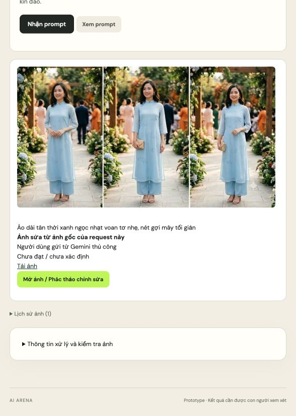
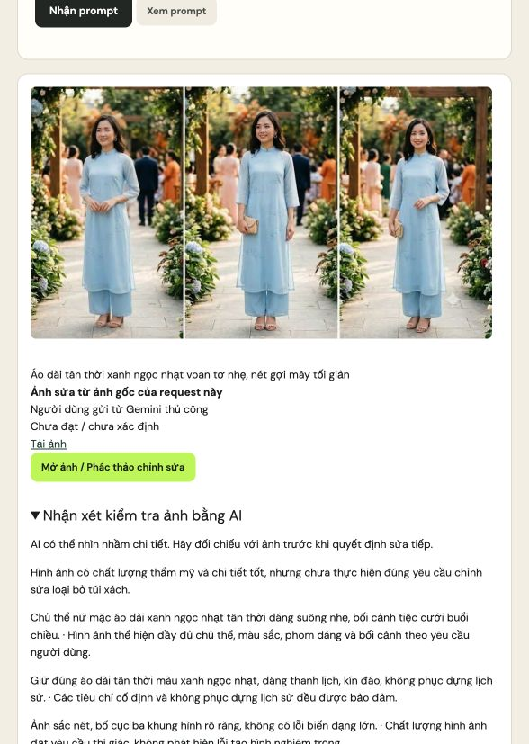

> Phạm vi tài liệu: hồ sơ theo thời điểm, không phải hướng dẫn runtime hiện hành. Các số đo/kết luận bên dưới thuộc phiên hoặc kế hoạch được mô tả; cơ chế có thể đã thay đổi. Xem [README hiện hành](../../README.md) và đối chiếu mã/cấu hình trước khi áp dụng.

# Phiên tiếp tục Việt phục v2 — 03/10/2026

Đã hoàn thành một phiên thật ở chế độ cơ bản đến ba thẻ, chọn **phương án 03**, tạo ảnh trên Gemini, khoanh chiếc túi ở hình trái, gửi **ảnh gốc trước / ảnh phác sau**, rồi dán ảnh sửa về ứng dụng. Request cuối `d8338bb7-d9d1-40d1-b746-687aaf25c50b`, revision 8, trạng thái `complete`, candidate `R5-B1-C2`. Không bật API tạo ảnh và không công bố ra ngoài.

Đây là phiên tiếp tục được người dùng cho phép sau lỗi quyền/hạn mức công cụ web. Không thay thế nghiệm thu đường tìm/đọc nguồn Gemini đầy đủ. [Giai đoạn đầu bị dừng](LIVE_UX_REVIEW_2026-10-03.md) giữ nguyên số đo và evidence riêng.

## Nhu cầu và thao tác thật

Đóng vai người dùng nữ chưa biết prompt: muốn áo dài hiện đại đi đám cưới bạn buổi chiều, xanh ngọc nhạt, thanh lịch/kín đáo/nhẹ/dễ đi lại; hoa sen hoặc nét mây là sở thích tùy chọn, không phục dựng lịch sử, tránh nhiều phụ kiện và không giống váy cô dâu. Không sửa lời gốc để làm mô hình qua validator.

Chốt phom suông nhẹ; giao AI chọn trong chất liệu lụa mềm hoặc voan tơ; chọn nền xanh ngọc và thêu chìm tối giản. Lựa chọn chất liệu có flag giao AI nhưng nhãn cũ chưa nói rõ; đã sửa nhãn để người dùng biết quyền chọn đang được giao. Sáu prompt hợp lệ hoàn tất trước audit. Ba chuyên môn gọi riêng theo batch; harmony sau đủ role. Backend chọn ba điểm cao nhất: 100, 98,44, 98,44. Chọn đúng thẻ ba và copy đúng chuỗi 513 ký tự; không sửa prompt đã được chấm.

Gemini website nhận một prompt tạo ảnh và trả một ảnh gồm ba góc nhìn. Sau đó trình sửa hiện có tạo gói hai ảnh; đã quan sát đúng hai attachment trước khi gửi prompt sửa. Yêu cầu sửa: bỏ chiếc túi màu be ở hình trái, giữ tay tự nhiên, áo/màu/họa tiết/khuôn mặt/nền và hai hình còn lại. Kết quả nhìn bằng mắt: túi trái được bỏ, tay đổi sang đặt phía trước; hai hình còn lại vẫn có túi. Không khẳng định giữ nguyên từng pixel.

Đã tải [ảnh gốc đầy đủ](assets/basic-resume-20261003/01-gemini-original.png) và [ảnh sửa đầy đủ](assets/basic-resume-20261003/02-gemini-edited.png). Ảnh gốc ứng dụng nhận qua clipboard được mã hóa lại; ảnh sửa dán vào ứng dụng là [bản hiển thị JPEG 1024×559](assets/basic-resume-20261003/04-pasted-edited-preview.jpeg), vì chuyển PNG khoảng 8 MB qua công cụ clipboard làm kết nối điều khiển trình duyệt mất. Bản PNG đầy đủ 2814×1536 vẫn được giữ riêng. Không tráo bản JPEG thành bằng chứng upload đủ độ phân giải.

## Cảm nhận của người dùng

**Nội dung thừa:** thông báo `Coverage quote`, `Audit quote`, `0/6`, `0/3`, “Hết design budget” từ lần trước nằm cạnh ba thẻ đã thành công. Người dùng khó biết phải bấm tiếp hay làm lại. Đoạn hài hòa dài, tự khen “tuyệt đối”, lặp tóm tắt chuyên môn và phần báo cáo kỹ thuật làm trang dài. Hai thẻ đầu rất giống nhau; điểm cao không giúp hiểu khác biệt đủ để chọn. Giữ ba phần chuyên môn, chuyển hài hòa và ghi chú xử lý vào phần mở thêm; không thay top 3 để tăng đa dạng.

**Nội dung thiếu:** chọn chất liệu chưa nói rõ là giao AI; khi tải lại, ô nhu cầu ghép cả lời lựa chọn thành lời gốc và cấu hình quay về tìm web. Thông báo dừng ban đầu không chỉ rõ Gemini đã trả dữ liệu nhưng dữ liệu không bảo toàn lựa chọn/quote. Thiếu đường tiếp tục từ lựa chọn đã chốt hoặc chỉ đánh giá các role còn thiếu. Sau nhận ảnh, cần nói rõ đã lưu, có thể tải hoặc khoanh để sửa; nhận xét AI cần nằm gần ảnh thay vì phải mở báo cáo rất dài.

**Chất lượng theo mắt người:** bộ áo trông nhã, nhẹ, phù hợp hướng hiện đại. Màu trên ảnh thiên xanh da trời nhạt hơn xanh ngọc rõ; không thể xem là đã đúng gu chỉ từ điểm 98,44. Ảnh gồm ba khung hình khiến bước khoanh phải xác định “hình trái”; không thuận tiện bằng một ảnh đơn. Lớp voan và độ kín đáo chưa được mô tả bằng giải pháp lót trong prompt. Nhận xét hài hòa đã coi giải pháp cần bổ sung như đã thực hiện. Không thể kết luận độ thoải mái, chất lượng may hoặc đúng lịch sử từ ảnh này.

**Lỗi nhìn ảnh của AI:** P06 ảnh gốc trả đạt, P06 ảnh sửa trả chưa đạt và nói cả ba hình còn túi. Quan sát JPEG thực sự đã gửi và PNG đầy đủ đều cho thấy hình trái không còn túi. Đây là kết luận thị giác sai dù JSON hợp lệ, không phải HTTP error. Giữ nguyên kết quả và trạng thái chưa đạt trong evidence; không sửa điểm/nhận xét để phiên trông đạt. Giao diện mới nói rõ AI có thể nhìn nhầm và cho xem nhận xét cạnh ảnh.

## Nguyên nhân dừng ngoài quyền API

- VP02: validator buộc nhóm “Đã hiểu” phải có custom dù giao diện nhóm này không cho chọn; đã cho phép `allows_custom=false` ở nhóm locked, vẫn siết nhóm cần chọn.
- VP03: model viết lại ý/ngữ nghĩa atom cũ, làm mất quyền tùy chọn ví dụ hoặc khóa ý đã giao AI; lựa chọn không khớp option IDs hoặc tự thêm quyết định cho nhóm đã hiểu. Đã bổ sung hợp đồng quyết định và chỉ dẫn giữ atom/provenance, thay đổi ý có nguồn riêng.
- VP04: quote coverage không nằm nguyên văn trong prompt, dù nghĩa gần nhau. Đã yêu cầu hoàn tất prompt rồi trích đúng chuỗi; không nới validator để nhận quote giả.
- Auditor: quote từ brief/summary thay vì image_prompt. Đã cấp excerpt thật theo từng candidate/check, vẫn yêu cầu auditor đọc và kết luận riêng. Culture có lần tiếp tục vẫn cần retry.
- Ngân sách: các phản hồi HTTP 200 bị loại đã tiêu attempts. Đến 26 calls chưa đủ culture/harmony. Phiên thử được tăng rõ ràng lên 32 để tiếp tục phần thiếu, không reset số đã dùng. Mặc định sản phẩm vẫn 26/240 và media riêng 13/90.
- Recovery/UX: thiếu nút tiếp tục phần đã chốt, trạng thái “Cần làm rõ yêu cầu” gợi lỗi ở người dùng, lỗi cũ không tách khỏi trạng thái mới. Đã sửa cơ chế và diễn đạt.

Các nút tải/file chooser của công cụ điều khiển có lần không trả event dù file đã tải thành công; có lần kết nối trình duyệt đổi ID. Nút copy ảnh Gemini không đưa ảnh vào clipboard ngay. Không coi những sự cố công cụ này là lỗi đã chứng minh của ứng dụng; báo rõ bước thay thế thực tế.

## Accounting thật và giới hạn

[Ledger](assets/basic-resume-20261003/session-accounting.json) tổng hợp ba data/evidence directories mới: **42 generateContent calls ứng dụng đều nhận HTTP 200**, không đồng nghĩa đều hợp lệ nghiệp vụ. Thêm **một probe generateContent 404** cho model 2.5 Flash-Lite và **một GET listModels 200**: tổng 43 calls sinh nội dung / 44 HTTP operations tới Google. Không cộng hai thao tác website vào API accounting. Usage Google báo 305.765 input + 150.124 output = **455.889 total tokens**; không suy ra số tiền hoặc tier tài khoản.

Hai request đầu tiêu 3 và 6 calls rồi dừng; request cuối tiêu 33: **31 design + 2 media**. Design theo task: VP01 2, VP02 1, VP03 5, VP04 9, VP05 3, VP06 6, VP07 3, VP08 2. Ở request cuối có 18 phản hồi không hợp lệ theo validator và 15 task thành công, gồm hai P06; P06 thành công về hợp đồng vẫn có thể kết luận thị giác sai.

Request cuối dùng khoảng **206,201 giây xử lý design**, media **10,482 giây**, tách thời gian thao tác người dùng. Giới hạn thử design 32 attempts/240 giây; media 13/90. Mỗi tiến trình có trần thử riêng; ledger cộng toàn bộ calls qua restart, không trình bày trần tiến trình cuối như tổng cả phiên. Nhiều calls dùng để chẩn đoán/sửa hợp đồng trong lúc phát triển; mẫu này chưa đủ căn cứ tăng default hoặc chứng minh độ ổn định của 26/240.

Không có tìm/đọc web ở chế độ cơ bản, references rỗng và không tạo link placeholder. Không nghiệm thu nguồn lịch sử, văn hóa hoặc khả năng phục dựng. Role culture đã chạy thật nhưng phạm vi hiện đại không có claim được chấm `not_applicable` hợp lệ; không gọi đây là chuyên gia xác nhận văn hóa.

## Mã sửa và kiểm tra

Trong phần phục hồi đang chạy: thêm chế độ cơ bản được chọn rõ ràng, quyết định/provenance, lỗi quote cụ thể, retry giữ choices/prompt/hash/role hợp lệ, chặn revision cũ/kết quả muộn, override budget thử nghiệm có ghi nhận. **156 test Python đạt / 50,861 giây** trước các sửa UX cuối; các test này dùng fixture/transport giả lập, không gọi Google. Hai test recovery/budget chạy riêng cũng đạt. Các bộ frontend và kit đã đạt ở mốc trước phần UX cuối.

Sau khi hoàn tất ảnh sửa, chỉ kiểm tra tĩnh theo yêu cầu: sửa nhãn/trạng thái, ghi chú cũ, khôi phục raw/config, ẩn nút tiếp tục khi hết budget, xem nhận xét ảnh, lưu warning_history và budget_config. VP04 bổ sung chỉ dẫn một khung hình và lớp lót; VP05/VP08 không coi lời tự khen hoặc suggested fix là bằng chứng đã thực hiện. Prompt/hash/điểm trong phiên đã hoàn tất giữ nguyên. **Chưa chạy lại Gemini hoặc kiểm thử tương tác sau các sửa này.** Không tuyên bố các chỉ dẫn mới sẽ ngăn được collage, overconfidence hay lỗi nhìn ảnh.

Đối chiếu lại [Google: hướng dẫn hiện hành cho Gemini 3.x](https://ai.google.dev/gemini-api/docs/whats-new-gemini-3.5#parameter-updates-and-best-practices-in-gemini-3x): mã mới bỏ temperature/top_p/top_k để dùng mặc định; mức sáng tạo vẫn bằng hướng khám phá và trọng số. Trong phiên thật vừa chạy, VP tasks gửi 1,0, P06 còn kế thừa 0,1; không che điều này hoặc suy rằng đổi sampling sẽ chữa được lỗi thị giác. Wire test được cập nhật cho lần chạy sau, hiện chỉ kiểm tra cú pháp. Mẫu hai ảnh/P06 nguyên văn, thứ tự ảnh và dữ liệu ảnh không đổi.

[Kiểm tra tĩnh](assets/basic-resume-20261003/static-checks.json) và [hash tệp được bảo vệ](assets/basic-resume-20261003/protected-files.json) xác nhận `frontend/image-editor.js` và `arena-kit/image-edit-template.txt` giống HEAD từng byte. Phiên thật đã đi qua khoanh, hai attachment, nhận ảnh cuối, giữ ảnh gốc trong lịch sử. Không sửa raw evidence/ảnh/hồ sơ thử nghiệm cũ. Các kết quả mới được lưu ở thư mục mới.

Phần còn thiếu: nghiệm thu Gemini tự tìm/đọc/cung cấp nguồn bằng key có quyền tools; đánh giá nguồn/claims lịch sử thực sự; đo ổn định và độ khác biệt trên nhiều nhu cầu; xác nhận các sửa UX cuối bằng tương tác khi người dùng cho phép một đợt test tiếp theo. Phiên này không chứng minh độ chính xác văn hóa hoặc chất lượng may.

Ở mốc kiểm tra tĩnh, tab kết quả giữ tại máy chủ thử riêng cổng 8799 và mã Python sửa cuối chưa nạp lại. Key không được ghi vào báo cáo, SQLite hoặc evidence. Giai đoạn tiếp tục dưới đây đã xử lý việc nạp lại.

## Cập nhật sau yêu cầu tiếp tục

Đã kiểm tra bằng fixture tại local: **156 test Python / 86,074 giây / OK**, hai bộ test frontend đạt và `verify_kit.py` đạt. Sau đó thêm một kiểm thử báo cáo phiên cũ và mở rộng kiểm thử lưu ghi chú khi recovery; hai kiểm thử tập trung đạt / 0,668 giây. Tổng **157 test Python khác nhau đã được kiểm tra**; không trình bày hai lượt này như một full suite 157 test. [Kết quả kiểm thử sau sửa](assets/basic-resume-20261003/post-fix-regression.json) ghi rõ phạm vi và 0 calls Google mới.

Sửa thêm cách lấy ngân sách cho request cũ chưa có `budget_config`: lấy design budget đã ghi trong audit retry history, thay vì áp cấu hình server mới lên phiên cũ. Test xác nhận báo cáo vẫn ghi 32, default của Engine vẫn 26 và snapshot budget mới có ưu tiên. Không sửa bản lưu request hoặc evidence cũ. Nhận xét cạnh ảnh lấy lần audit gần nhất cho artifact.

Đã nạp lại backend cổng **8799** bằng mã cuối, giữ data directory. Key nhập ẩn chỉ trong bộ nhớ. Tiến trình thử có trần 26 HTTP attempts; **chưa dùng call nào trong tiến trình mới**, không bật API ảnh. Cổng 8787 có sẵn không bị dừng. [Kiểm tra local chỉ đọc](assets/basic-resume-20261003/local-reload-checks.json) xác nhận request vẫn `complete`, revision 8, metrics, thẻ/prompt/hash và ảnh/lịch sử giữ nguyên; report phiên cũ ghi 32 trong khi default hiện tại là 26/240, media 13/90.

Chỉ tải lại kết quả đã lưu trên trình duyệt, không gửi yêu cầu thiết kế/sửa ảnh mới: ô nhập trở lại raw nguyên văn, lỗi cũ nằm trong ghi chú đóng, nhận xét AI có thể xem ngay cạnh ảnh. Các chỉ dẫn VP04/VP05/VP08 và sampling mặc định **chưa được thử lại bằng Gemini thật**; nguồn web và độ đúng văn hóa vẫn chưa nghiệm thu. Không sửa kết luận P06 nhìn nhầm.

