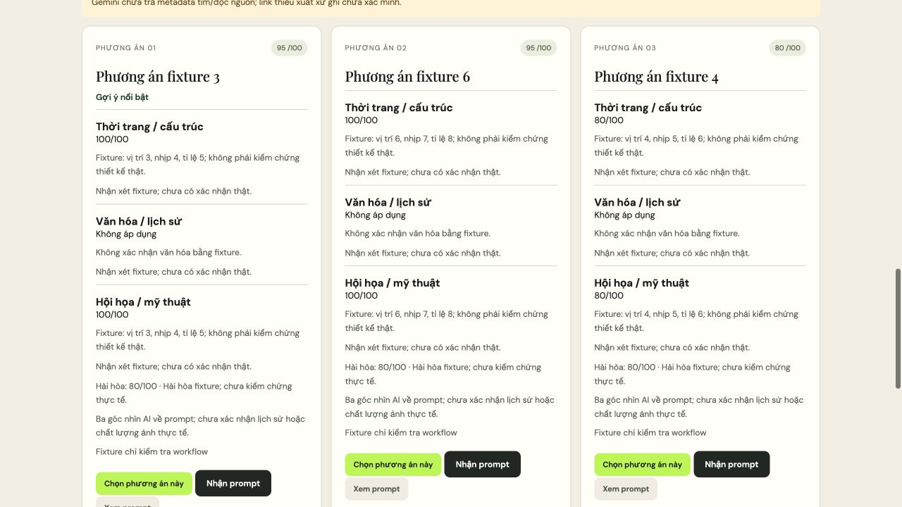

> Phạm vi tài liệu: hồ sơ theo thời điểm, không phải hướng dẫn runtime hiện hành. Các số đo/kết luận bên dưới thuộc phiên hoặc kế hoạch được mô tả; cơ chế có thể đã thay đổi. Xem [README hiện hành](../../README.md) và đối chiếu mã/cấu hình trước khi áp dụng.

# Kết quả triển khai Việt phục v2

**Mốc cập nhật:** [Phiên đầu](LIVE_UX_REVIEW_2026-10-03.md) dừng ở VP02; [phiên cơ bản tiếp tục](BASIC_RESUME_UX_2026-10-03.md) đã tới ba thẻ, ảnh và một lượt chỉnh sửa thật. Sau lần kiểm tra tĩnh, đã kiểm tra lại local: full suite 156 test đạt, thêm một test mới và mở rộng một test được kiểm tra tập trung; 157 test Python khác nhau đã được kiểm tra. Hai bộ frontend và kiểm tra kit đạt. Backend 8799 đã nạp mã cuối, dữ liệu phiên cũ giữ nguyên. Giai đoạn tạo/sửa ảnh dùng 42 calls ứng dụng, một probe 404 và một GET danh sách model; đợt local sau đó dùng 0 calls Google. Các số 148 test/0 API bên dưới thuộc mốc triển khai fixture ban đầu, không phải tổng hiện tại.

Ngày đối chiếu và kiểm tra: **03/10/2026**. Mã v2 đã chạy trong workspace, là workflow mặc định. **148 test Python đạt: 110 test hồi quy hiện có và 38 test v2. Hai bộ test frontend và kiểm tra kit đạt. Số lần gọi Gemini thật: 0.** Không có `GEMINI_API_KEY` trong môi trường; chưa nghiệm thu chất lượng nghiệp vụ, nguồn hoặc thời gian bằng model thật. Không công bố hay triển khai ứng dụng ra ngoài.

## Thay đổi đã thực hiện

Đã đọc kế hoạch, README bộ prompt và từng VP00–VP08/VP02R, đối chiếu Engine, provider, contracts, Store, ranking, report, frontend và phần ảnh trước khi sửa. Trình tự thực hiện theo mục 12: kiểm tra baseline → schema/validator/loader → VP01–VP03 và lựa chọn/nguồn → VP04 và điều phối → bốn audit/điểm → thẻ/adapter → mặc định/tài liệu → kiểm thử.

| Phần | Kết quả trong mã |
|---|---|
| Nội dung mở | Lưu raw nguyên văn; clean_text, domains/atoms/relations/coverage và quote theo lượt. Không gọi ontology/validate_brief v1 cho phần thiết kế v2. Envelope có schema; tên miền, phom và ý mở. |
| Checklist | Nhóm đã hiểu hoặc cần chọn, một/nhiều, AI/custom, dependencies và exclusions. Không chọn sẵn. Xác nhận riêng khi đổi ý; giữ custom nguyên văn. Endpoint kiểm tra revision/form/idempotency. |
| Nguồn | VP02 dùng `googleSearch` và `urlContext`; VP02R rồi VP02 khi cần tách. Gemini thực hiện toàn bộ tìm/đọc/chọn nguồn. Default pack rỗng sources/rules/knowledge_units; không có bước vận hành nhập/duyệt link. |
| Provenance nguồn | Giữ grounding/URL metadata ngoài JSON model. URL phải khớp metadata công cụ; URL chưa có xuất xứ bị bỏ khỏi link sản phẩm. Search không chứng minh đã đọc: excerpt chỉ giữ khi có URL retrieval thành công. Preview cũng cần URL trong metadata; thiếu ảnh vẫn xem giải thích/chi tiết. |
| Sinh prompt | Hai VP04 × ba slots do backend cấp; hướng khám phá lấy từ creative_space và mức sáng tạo. Chờ các lượt sinh kết thúc, xử lý thiếu có giới hạn rồi mới audit pool. |
| Chuyên môn | VP05 thời trang, VP06 văn hóa/lịch sử, VP07 mỹ thuật là ba calls riêng cho từng batch, không có nhận xét đồng nghiệp trong input. VP08 nhận cả ba kết quả hợp lệ, đúng candidate/revision/hash. |
| Điểm và chọn | Backend kiểm tra đúng bốn tiêu chí mỗi role, rating nguyên 0–5, hard checks và applicability; chuyên môn không áp dụng là null, phân bổ lại trọng số phần còn áp dụng. Backend tính điểm rồi lấy ba cao nhất đủ điều kiện. Bằng điểm theo candidate_id. Chỉ loại trùng prompt/kế hoạch thực sự, không đổi thứ tự theo mức gần nhau hoặc đa dạng. |
| Prompt bất biến | Hash gồm prompt, kế hoạch, ba mô tả, quyết định, claims, coverage, assumptions và limitations. Adapter/copy dùng nguyên văn prompt đã audit; các điểm đọc/bàn giao ảnh từ chối nội dung bị đổi. |
| Thiếu kết quả | Bổ sung tối đa một batch nếu còn ít nhất năm attempts và thời gian; vẫn thiếu thì báo số đạt thật. Giữ các audit hợp lệ khi một role lỗi, không tạo điểm giả hoặc chuyển mock. |
| Điều phối | Call records riêng, cập nhật job mới dưới khóa, giới hạn API và attempts, worker API riêng, rào chờ pool, checkpoint từng task/role và hồi phục phần còn thiếu. Hủy/revision cũ không nhận kết quả muộn vào thiết kế hiện tại. |
| Accounting | Observer transport ghi ID và actual HTTP attempts trước khi gửi, gồm calls lỗi. Design/media tách riêng; trace lưu task/role/batch/revision, hash, usage và tool metadata. Số Search queries được báo riêng theo metadata, không coi là số queries tính tiền. |
| Giao diện/report | Ba thẻ có ba phần chuyên môn và hài hòa; Nhận prompt copy mỗi lần bấm, Xem prompt riêng và có fallback chọn văn bản. Report giữ raw → clean → choices → resolved → batches → audits → top 3 → ảnh và budget/API. |

Các file chính: [schema](../../backend/viet_phuc/contracts.json), [task config/rubric](../../backend/viet_phuc/config.json), [validators](../../backend/arena_backend/viet_phuc.py), [workflow](../../backend/arena_backend/viet_phuc_workflow.py), [adapter](../../backend/arena_backend/viet_phuc_adapter.py), [test v2](../../backend/tests/test_viet_phuc_v2.py), [frontend test v2](../../frontend/tests/viet-phuc-v2.test.cjs). Bộ prompt `.txt` được nạp trực tiếp từng tệp; không thay nội dung VPxx để làm fixture dễ đạt.

## Cấu hình khởi đầu giữ nguyên

- Sáu prompt: hai lượt sinh × ba; tối đa một batch bổ sung.
- Mặc định khám phá, ưu tiên sáng tạo: F/C/A/H **25/20/35/20**. Bộ cân bằng **30/25/25/20**. Ngưỡng **70/100**.
- Design **26 attempts / 240 giây chủ động**; media **13 / 90** riêng. Chờ người dùng chốt hoặc tạo ảnh không tính. Retry task tối đa một lần, tiêu attempts.
- Hai call sinh cùng lúc và ba call chuyên môn mỗi request; semaphore API chung tối đa ba. Harmony chỉ chạy khi đủ ba role.
- Baseline không retry/bổ sung: **13 calls trước ảnh**; nhánh VP02R **14**. Một batch bổ sung cần năm calls. P06 và media tiêu ngân sách media, không bị trần 13 cũ của toàn luồng chặn.

Ở mốc ban đầu, đã đối chiếu [model Gemini 3.5 Flash-Lite](https://ai.google.dev/gemini-api/docs/models/gemini-3.5-flash-lite), [temperature Gemini 3](https://ai.google.dev/gemini-api/docs/gemini-3#temperature), [structured outputs](https://ai.google.dev/gemini-api/docs/structured-output), [Google Search](https://ai.google.dev/gemini-api/docs/google-search), [URL Context](https://ai.google.dev/gemini-api/docs/url-context) và [REST GenerateContent](https://ai.google.dev/api/generate-content); VP tasks gửi temperature 1,0. Sau phiên tiếp tục, mã hiện hành bỏ sampling overrides theo [hướng dẫn Gemini 3.x mới](https://ai.google.dev/gemini-api/docs/whats-new-gemini-3.5#parameter-updates-and-best-practices-in-gemini-3x), kể cả P06 trên Gemini 3. Sáng tạo được thể hiện bằng hướng khám phá, rubric và trọng số. Việc bỏ override mới kiểm tra tĩnh, không chứng minh auditor chính xác hơn.

Không đổi các con số khởi đầu dựa trên thời gian fixture. Timeout/token cap theo task được ghi là `initial_unbenchmarked`; chưa có số đo Gemini thật làm căn cứ điều chỉnh.

## Kiểm thử và đối chiếu mục 13

```bash
PYTHONPATH=backend python3 -m unittest discover -s backend/tests -v
node frontend/tests/request-state.test.cjs
node frontend/tests/viet-phuc-v2.test.cjs
python3 arena-kit/verify_kit.py
python3 -m compileall -q backend/arena_backend backend/tests
node --check frontend/app.js
git diff --check
```

Lần chạy cuối Python: **148 tests / 31,957 giây / OK**. Các lệnh còn lại đạt. Kiểm tra kit xác nhận chín task templates VP (VP00 là system), schema/rubric v2, hai profile, công thức ví dụ **84,4**, default pack không có nguồn chuẩn bị sẵn và P06 giống bản gốc.

| Nhóm nghiệm thu | Bằng chứng và giới hạn |
|---|---|
| Giữ ý mở/quyền chọn/không suy thêm | Fixture semantic viết tay có âu phục, xanh, ví dụ sen/rồng/mây, quyền không dùng hết, vải nhẹ, đám cưới không chỉ định giới tính, giao AI và miền túi cảm biến. Test giữ quote, provenance, intent, custom, supersedes và điều khóa qua resolved/prompt. Đây là kiểm tra hợp đồng với output đã biết, chưa chứng minh Gemini hiểu đúng yêu cầu thật. |
| Đúng miền | Schema/validator và frontend nhận miền/nhóm do provider trả, không phân loại phom bằng regex hoặc catalog. Chưa so sánh ba bảng thật cho âu phục, váy cảm hứng mỹ thuật và áo ngũ thân tái hiện. |
| Nguồn/xem nhanh | Test metadata search/read, URL bịa, preview đoán, retrieval lỗi, tools 403, tools/schema 400 và VP02R. Frontend test giải thích thiếu link/ảnh và details/tooltip. Fixture UI local dùng markup thực tế: Enter mở details, focus SUMMARY hiện tooltip không chặn click; ở 390×844 vẫn mở giải thích, không có anchor/img giả, không tràn ngang. Chưa kiểm tra độ đúng nguồn, redirect, đoạn trích hoặc ảnh do Gemini thật chọn. |
| Checklist/đổi ý | Test cardinality, exclusions, dependencies/DAG, AI/custom, gửi trùng, form/revision cũ và xác nhận đổi màu. Frontend test không chọn sẵn, dependency ba tầng bị xóa khi đổi nhóm nền, AI/custom loại trừ. |
| Sáng tạo/rào pool | Test sáu kế hoạch fixture khác nhau; giữ nhóm sinh thứ hai đang chạy và xác nhận chưa có audit. Khác biệt có ý nghĩa trên model thật chưa đo. |
| Ba role/harmony | Test đầu vào độc lập, thiếu/sai role/check/criterion/hash/quote/applicability và harmony thiếu role. Lỗi một role giữ hai role khác, không chấm harmony cho batch thiếu. |
| Văn hóa | Test chặn claim nguồn đoán, historical ready thiếu nguồn/đoạn, giữ historical khi needs_evidence; không tự chuyển sang cảm hứng. Chưa nghiệm thu tính đúng văn hóa bằng chuyên gia hoặc nguồn thật. |
| Điểm/top 3 | Test phép tính sai được tính lại, null khi không áp dụng, rating sai, nguồn điểm bị đổi, hard uncertain không được điểm đẹp bù, top 3 đúng điểm dù gần nhau, bằng điểm ổn định, loại bản trùng sau khi xếp điểm và tối đa một batch bổ sung. |
| Bất biến/recovery/accounting | Test đổi prompt/handoff bị chặn, restart chỉ gọi role thiếu, P06 media recovery riêng, hủy/kết quả muộn, attempts song song không vượt trần. Transport giả lập observer cả lỗi và thành công; không gửi HTTP tới Google. |
| Giao diện | Smoke local qua trình duyệt: chưa chọn → bị chặn; chốt AI → ba thẻ; copy lần một và hai cùng 233 ký tự. Ở 390×844, clipboard vẫn 233 ký tự, scrollWidth=clientWidth=390. Chưa thử link/tooltip có nguồn thật trên thiết bị cảm ứng thực. |
| Giữ phần ảnh | Hồi quy hiện có và test v2 chọn thẻ thứ ba → nhận ảnh → hai vòng phác/sửa với template hai ảnh → cập nhật ảnh cuối → restart. Test revise giữ ảnh cũ, vô hiệu output hiện tại, chọn thẻ mới và chặn bước ảnh cũ. |
| Phạm vi sản phẩm/lịch sử | Hướng dẫn vận hành, frontend, report v2 và default pack dùng nghiệp vụ Việt phục. Các template/pack v1 còn lại phục vụ đọc và hồi quy lịch sử; API sản phẩm chặn tạo mới v1. |

### Phân biệt fixture và API thật

`MockProvider` công khai output là fixture, không gọi API ảnh và không đóng vai chuyên gia thật. `OpenAtoms` là fixture semantic viết tay. Các test provider sử dụng response/transport được inject, kể cả khi tên provider là `gemini` để kiểm tra accounting; con số calls trong các job đó là số giả lập của phép thử. **Không có calls Google thực tế, không có nguồn thực tế được nghiệm thu.**

Schema, quote, citation và hash giúp kiểm tra toàn vẹn dữ liệu; chúng không đo tính đúng của ý nghĩa, đoạn trích hoặc văn hóa. URL retrieval thành công cũng không xác minh đoạn model trích hay loại nguồn model gán. Bốn lượt vẫn có thể đồng thuận sai vì cùng Gemini. Matching URL đang bảo thủ theo URL metadata chính xác; cần đo redirect/canonical URL trên tài khoản/model thật. Preview có thể không có vì metadata không cung cấp URL ảnh.

### Ranh giới phần ảnh

`frontend/image-editor.js` và `arena-kit/image-edit-template.txt` **byte-identical với HEAD**, có test tự đối chiếu. P06 cũng giống nguyên văn bản trước. Thứ tự ảnh gốc trước/ảnh phác sau, khoanh/phác, paste ảnh hoàn thiện và cập nhật ảnh hiện hành không đổi.

Điểm nối ở adapter và wrapper giao tiếp v2: kiểm tra hash, chuyển miền mở vào brief/invariants/extensions, và khi revise chỉ cho thao tác với candidate hiện tại mà vẫn giữ artifact cũ. Trong `image_workflow.py`, đúng một biểu thức kiểm tra số calls còn lại chuyển sang `budget.calls_remaining()` để dùng media budget riêng; test v1 xác nhận hành vi cũ và test v2 xác nhận sau 13 design attempts vẫn chạy P06.

Không sửa raw evidence, ảnh, manifest hay hồ sơ benchmark cũ. Không chạy xây lại evidence hoặc sửa verifier lịch sử để kết quả cũ qua với mã mới. Các test mới dùng temporary directories; smoke UI dùng `/tmp/viet-phuc-v2-ui-smoke`. Ảnh dưới đây là bằng chứng giao diện fixture mới, không phải kết quả đánh giá thiết kế thực tế.



## Phần còn cần nghiệm thu thực tế

Khi có key, dùng state/evidence directory mới và một tiến trình giới hạn calls, ví dụ:

```bash
PYTHONPATH=backend python3 -m arena_backend --prompt-key --max-api-calls 20 \
  --data-dir /tmp/viet-phuc-v2-live-check \
  --evidence-dir /tmp/viet-phuc-v2-live-evidence
```

Giới hạn **20 HTTP attempts toàn tiến trình**, gồm retry/media; không bật `--images`. Chạy một yêu cầu đại diện, lưu raw, checklist, metadata nguồn, resolved, prompt hashes, bốn audit, actual calls/usage, tỷ lệ giữ ý, số phương án khác nhau/đạt và thời gian theo stage. Nguồn/cultural claims phải đọc và đối chiếu với phạm vi; thử phản ví dụ trước khi kết luận độ chính xác. Các yêu cầu đại diện khác dùng phiên chạy có trần riêng và ghi tổng calls rõ ràng.

Ở mốc fixture ban đầu, thiếu key ngăn nghiệm thu API thật trong bước 12.8. Phiên tiếp tục đã bổ sung một mẫu hiện đại ở chế độ cơ bản; nguồn web, phục dựng lịch sử, tính đúng chuyên môn và độ ổn định trên nhiều yêu cầu vẫn còn thiếu bằng chứng. Cấu hình mặc định vẫn 26/240 và 13/90; không coi các kiểm thử đã đạt là bằng chứng văn hóa chính xác.
