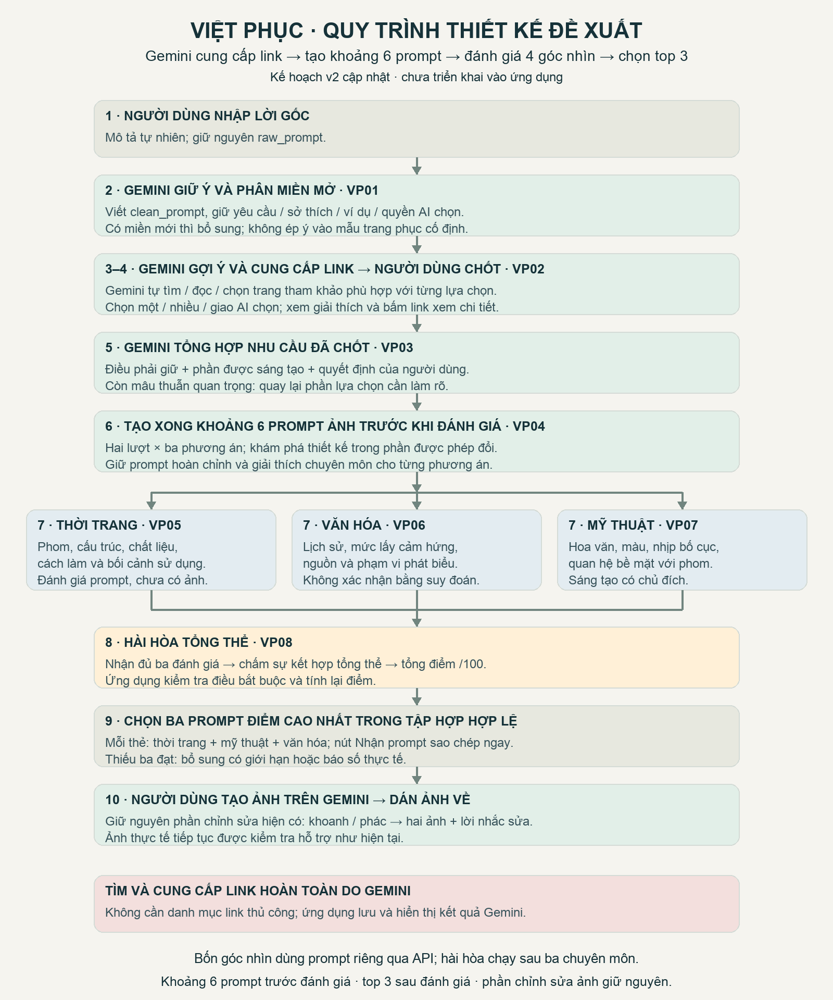

> Phạm vi tài liệu: hồ sơ theo thời điểm, không phải hướng dẫn runtime hiện hành. Các số đo/kết luận bên dưới thuộc phiên hoặc kế hoạch được mô tả; cơ chế có thể đã thay đổi. Xem [README hiện hành](../../README.md) và đối chiếu mã/cấu hình trước khi áp dụng.

# Kế hoạch chuyển ứng dụng sang quy trình thiết kế Việt phục

**Trạng thái cập nhật 03/10/2026: mã v2 đã triển khai trong workspace và kiểm thử fixture/hồi quy đạt; chưa nghiệm thu bằng Gemini thật.** Xem [báo cáo triển khai](IMPLEMENTATION_REPORT.md). Phần đối chiếu “hiện tại” ở mục 1 ghi baseline trước thay đổi. **Gemini tự tìm/cung cấp link; khoảng sáu prompt ảnh trước đánh giá bốn góc nhìn; chọn ba kết quả tốt nhất.**

Mục tiêu là hiểu ý người dùng, giúp họ chốt những lựa chọn còn mơ hồ, tạo nhiều hướng thiết kế, đánh giá theo ba chuyên môn và mức hài hòa chung, rồi chọn ba lời nhắc tạo ảnh tốt nhất. Quy trình chỉ phục vụ sản phẩm Việt phục; không có bước đọc đề, chấm bài hay chuẩn bị dự thi.

Nội dung lời nhắc đặt riêng trong [thư mục prompts](prompts/README.md). Lời giao việc cho phiên triển khai tiếp theo đặt trong [BAT_DAU_TRIEN_KHAI.txt](BAT_DAU_TRIEN_KHAI.txt). Những con số về số phương án, trọng số và thời gian dưới đây là **thiết lập khởi đầu đề xuất**, cần đo khi thử nghiệm; không phải giới hạn người dùng đã yêu cầu.

## 1. Kết luận đối chiếu với ứng dụng hiện tại

| Phần | Hiện tại | Cần làm cho quy trình mới |
|---|---|---|
| Nhập yêu cầu | Ô văn bản tự do; API nhận `input` | Giữ ô nhập. Lưu bản gốc dưới tên `raw_prompt`; vẫn nhận `input` để tương thích. |
| Hiểu nhu cầu | P02/P10 trả bản ghi với các trường cố định; loại trang phục phải có trong danh sách đang hỗ trợ | Dùng nội dung tự do có phân miền; cho phép thêm miền, kiểu dáng và chi tiết mới; giữ đầy đủ ý gốc. |
| Làm rõ | Hỏi từng câu, chỉ câu cần thiết để tiếp tục; tối đa hai vòng | Tạo bảng lựa chọn theo miền nghiệp vụ, có giải thích và tham khảo; cho chọn một, nhiều hoặc giao AI đề xuất. |
| Tài liệu | Gói mặc định còn chứa yêu cầu sản phẩm cũ; gói áo dài chỉ có ba phát biểu văn hóa từ một nguồn du lịch | Gemini tự tìm, đọc và cung cấp link phù hợp theo từng nhu cầu. Không cần danh mục link do đội vận hành chuẩn bị; nguồn tìm được phải ghi rõ nội dung/phạm vi hỗ trợ. |
| Tạo ý tưởng | P03 sinh tối đa ba phương án; P05 ghép lời nhắc bằng ứng dụng | Gemini viết nhiều lời nhắc tạo ảnh hoàn chỉnh, qua nhiều lượt gửi; mục tiêu sáu phương án ban đầu trước đánh giá. |
| Đánh giá | P04 đánh giá tất cả chuyên môn trong một lượt; điểm 0–4 rồi ứng dụng quy đổi | Ba vai trò riêng: thời trang, văn hóa, mỹ thuật; sau đó vai trò thứ tư đọc cả ba nhận xét để chấm hài hòa và tổng điểm /100. |
| Chọn | Điểm gần nhau có thể đổi thứ tự theo mức phù hợp; lọc phương án chưa đủ khác biệt | Chọn đúng ba điểm tổng cao nhất trong tập hợp hợp lệ, không áp dụng cách đổi thứ tự cũ. |
| Thẻ kết quả | Có mô tả, điểm, nguồn và nút mở/ẩn lời nhắc; lần mở đầu có sao chép | Tách ba phần chuyên môn; nút **Nhận prompt** luôn sao chép ngay khi bấm, kể cả lần thứ hai. |
| Tạo ảnh | Đã có cách mang lời nhắc sang Gemini và gửi ảnh về | Giữ cách này làm đường đi chính; đưa đúng lời nhắc đã được đánh giá tới người dùng. |
| Chỉnh sửa ảnh | Khoanh/vẽ, giữ phần không sửa, hai ảnh tham chiếu, đưa ảnh mới về, kiểm tra hỗ trợ | **Giữ hành vi và giao diện hiện có.** Chỉ nối dữ liệu từ quy trình mới vào phần ảnh. |

Các điểm trong bảng được đối chiếu với `Engine._run`, `Domain.validate_brief`, `rank_candidates`, `GeminiProvider.structured`, `renderQuestion`, `renderCards` và `ImageWorkflow` trong mã dự án.

## 2. Quy trình nghiệp vụ dự kiến

### Bước 1 — Người dùng nói điều muốn làm

- **Ai / lời nhắc:** Người dùng nhập `raw_prompt`; chưa gọi Gemini.
- **Thao tác:** Mô tả tự nhiên; không bắt điền một mẫu cố định. Giữ cả lỗi gõ, điều phủ định, ví dụ minh họa và câu cho phép AI tự chọn.
- **Kết quả:** Bản gốc nguyên văn được lưu để đối chiếu trong các bước sau.
- **Lý do:** Giữ provenance và tránh mất ý do ép người dùng vào biểu mẫu sớm.

### Bước 2 — Giữ ý quan trọng, chia thành các miền

- **Ai / lời nhắc:** API Gemini, mẫu **VP01**.
- **Thao tác:** Viết lại nhu cầu cho rõ hơn nhưng không làm ngắn bằng cách bỏ ý. Chia nội dung thành các nhóm có tên dễ hiểu. Một chi tiết có thể liên quan tới nhiều nhóm. Có ý ngoài các nhóm quen thuộc thì tạo nhóm mới.
- **Kết quả:** `clean_prompt` gồm bản diễn đạt đầy đủ và các ý có chỗ trích từ lời gốc. Phân biệt điều bắt buộc, sở thích, ví dụ được phép lựa chọn, điều giao AI quyết định, điều chưa rõ và điều mâu thuẫn.
- **Lý do:** Có cấu trúc để xử lý, nhưng không dùng ontology hoặc template nội dung cố định làm mất yêu cầu.

### Bước 3 — Tìm phần chưa hình dung rõ và đề xuất cách chọn

- **Ai / lời nhắc:** API Gemini, mẫu **VP02**, nhận lại cả `raw_prompt` và `clean_prompt`.
- **Thao tác:** Đọc lại từng ý để phát hiện phần bị bỏ sót, rồi xác định điều cần biết thêm để thiết kế tốt: dịp dùng, phom dáng, chất liệu, bảng màu, cảm hứng mỹ thuật, cách thể hiện hoa văn, mức liên hệ lịch sử… Với từng chỗ mơ hồ, đưa vài lựa chọn phù hợp và nói ngắn vì sao nên chọn. Gemini tự tìm trang tham khảo, đọc phần liên quan và cung cấp link cho các lựa chọn bằng khả năng tìm/đọc web tích hợp của Gemini.
- **Kết quả:** Bảng lựa chọn chia theo miền; chỉ hỏi điều có ảnh hưởng. Nội dung đã rõ hiện như phần đã hiểu, không bắt người dùng chọn lại. Nếu bản chuẩn hóa bị mất ý, sửa và kiểm tra bản đó trước khi hiển thị bảng.
- **Lý do:** Clarification theo nghiệp vụ: phom váy, chất liệu và nguồn cảm hứng là những quyết định khác nhau, không thể gom thành một câu hỏi phong cách chung.

### Bước 4 — Người dùng chốt bảng lựa chọn

- **Ai / lời nhắc:** Người dùng; ứng dụng kiểm tra lựa chọn, chưa cần một lời nhắc mới.
- **Thao tác:** Chọn một kiểu dáng, chọn một/vài hoa văn được phép kết hợp, xem phần giải thích khi trỏ chuột hoặc bấm. Có lựa chọn **Để AI đề xuất** và chỗ bổ sung bằng chữ. Bấm **Chốt lựa chọn**. Không chọn gì không được hiểu là đồng ý với một giá trị ngầm.
- **Kết quả:** Các lựa chọn được lưu riêng, gắn đúng câu hỏi và phiên bản bảng. Phần chưa quyết định ghi rõ là giao AI chọn hoặc cần làm rõ tiếp.
- **Lý do:** User consent và dependency validation giúp tránh lựa chọn trái nhau, chẳng hạn đổi nền trang phục nhưng vẫn giữ câu hỏi phom cũ.

### Bước 5 — Tổng hợp nhu cầu đã chốt

- **Ai / lời nhắc:** API Gemini, mẫu **VP03**; ứng dụng kiểm tra việc giữ ý.
- **Thao tác:** Ghép nhu cầu gốc với lựa chọn vừa chốt. Nếu lựa chọn mới thay đổi yêu cầu gốc, phải có thao tác đổi rõ ràng của người dùng; lựa chọn tham khảo không được tự xóa điều bắt buộc.
- **Kết quả:** `resolved_brief` có lời mô tả cuối đầy đủ, điều phải giữ, phần được phép sáng tạo và những lựa chọn giao AI quyết định. Nếu còn mâu thuẫn quan trọng, trả lại phần tương ứng của bảng; không bắt nhập lại toàn bộ.
- **Lý do:** Tránh semantic drift ở điểm nối giữa lựa chọn giao diện và đầu vào sinh ý tưởng.

### Bước 6 — Tạo nhiều hướng và nhiều lời nhắc ảnh

- **Ai / lời nhắc:** Ứng dụng chuẩn bị các hướng khám phá; API Gemini gọi **VP04** nhiều lần.
- **Thao tác:** Mục tiêu ban đầu hai lượt gửi, mỗi lượt tạo ba prompt ảnh: tổng sáu phương án. Lưu đủ sáu prompt hợp lệ về cấu trúc trước khi bắt đầu đánh giá bốn góc nhìn; nếu ít hơn vì lỗi hoặc phạm vi quá hẹp, báo số thực tế và xử lý bổ sung có giới hạn. Hai lượt cùng giữ nhu cầu đã chốt nhưng khám phá phần được phép đổi, ví dụ vị trí hoa văn, nhịp mảng màu, cách thêu/đắp nổi, cấu trúc lớp áo. Không đổi kiểu dáng đã chốt để làm khác biệt.
- **Kết quả:** Mỗi phương án có một lời nhắc ảnh hoàn chỉnh và ba phần giải thích: thời trang; mỹ thuật/hoa văn; văn hóa/lịch sử. Có danh sách ý bắt buộc đã thể hiện để đối chiếu.
- **Lý do:** Exploration plan tạo khác biệt có chủ đích. Tăng temperature đơn thuần không bảo đảm sáng tạo tốt hoặc giữ yêu cầu.

### Bước 7 — Ba vai trò chuyên môn đánh giá riêng

- **Ai / lời nhắc:** Ba lượt API Gemini riêng cho mỗi nhóm phương án: **VP05 thời trang**, **VP06 văn hóa**, **VP07 mỹ thuật**.
- **Thao tác:** Sau khi tập khoảng sáu prompt đã được tạo xong, mỗi vai trò nhận đúng lời nhắc ảnh và thông tin liên quan, đọc theo tiêu chí chuyên biệt. Không nhận điểm hoặc nhận xét của hai vai trò còn lại ở lần đánh giá đầu.
- **Kết quả:** Điểm từng chuyên môn, điểm mạnh, lỗi, điều chưa rõ và sửa gì nếu cần. Mọi kết luận phải chỉ tới nội dung thực sự có trong phương án; nhận xét văn hóa cần căn cứ phù hợp.
- **Lý do:** Role separation giảm việc một nhận xét chung bỏ sót chuyên môn. Cùng dùng Gemini vẫn có lỗi tương quan; đây là ba góc nhìn AI, không phải xác nhận của ba chuyên gia thật.

### Bước 8 — Chấm mức hài hòa và tổng điểm /100

- **Ai / lời nhắc:** API Gemini, mẫu **VP08**, chỉ chạy sau khi có đủ ba nhận xét hợp lệ của mỗi phương án.
- **Thao tác:** Xem phom dáng, chất liệu, hoa văn, màu và ý nghĩa có hỗ trợ nhau không; xử lý chỗ các nhận xét mâu thuẫn. Chấm hài hòa, nêu lý do chọn hoặc loại và đưa tổng điểm theo công thức đã đặt.
- **Kết quả:** Tổng điểm /100 và giải thích ngắn. Ứng dụng tính lại phép tính, không giao quyền sửa trọng số hoặc bỏ qua lỗi bắt buộc cho Gemini.
- **Lý do:** Một thiết kế có từng chi tiết tốt vẫn có thể không hài hòa. Deterministic scoring ngăn lỗi số học và việc auditor tự đổi luật.

### Bước 9 — Chọn ba phương án tốt nhất và hiển thị

- **Ai / lời nhắc:** Ứng dụng chọn từ điểm đã kiểm tra; không gọi thêm Gemini để viết lại lời nhắc thắng cuộc.
- **Thao tác:** Loại phương án vi phạm yêu cầu hoặc căn cứ bắt buộc. Trong phần còn lại, sắp điểm giảm dần và lấy ba phương án cao nhất. Mỗi thẻ nêu rõ ba phần chuyên môn, điểm tổng và mức chắc chắn về lịch sử.
- **Kết quả:** Ba lựa chọn có nút **Nhận prompt** sao chép đúng nguyên văn lời nhắc vừa được đánh giá. Nếu chưa đủ ba phương án đạt, thử một lượt bổ sung trong giới hạn; vẫn không đủ thì báo số đạt thực tế.
- **Lý do:** Audit phải gắn với đúng prompt cuối; không sửa prompt sau khi chấm rồi dùng điểm cũ.

### Bước 10 — Tạo ảnh và tiếp tục chỉnh sửa như hiện tại

- **Ai / lời nhắc:** Người dùng chọn phương án, sao chép lời nhắc, gửi sang Gemini, rồi dán ảnh vào ứng dụng.
- **Thao tác:** Dùng khu vực nhận ảnh và trình chỉnh sửa đang có: khoanh/vẽ, mô tả thay đổi, nhận hai ảnh cùng lời nhắc sửa, đưa ảnh hoàn thiện trở lại.
- **Kết quả:** Ảnh gắn đúng phương án; phần chỉnh sửa và kiểm tra ảnh hỗ trợ giữ hành vi hiện có.
- **Lý do:** Chuyên môn ở bước 7–8 đánh giá kế hoạch và lời nhắc; chỉ sau khi có ảnh mới biết ảnh thực tế đã làm đúng tới đâu.

## 3. Chia miền linh hoạt mà không ép ý vào mẫu

**Nguyên tắc:** cấu trúc chứa dữ liệu có thể cố định để ứng dụng đọc được; **nội dung và số miền phải mở**. Không bắt mọi yêu cầu có đủ sáu nhóm, không dùng một trường `subject` làm toàn bộ bản thiết kế, không bỏ chi tiết chưa có trong danh mục.

Các miền sau là gợi ý khởi đầu, không phải danh sách đóng:

| Miền | Phần cần phân biệt | Ví dụ điều có thể hỏi |
|---|---|---|
| Bối cảnh sử dụng | Người mặc nếu được nêu, dịp, địa điểm, mức trang trọng, điều kiện vận động | Mặc dự tiệc, biểu diễn hay chụp bộ ảnh? |
| Thời trang và cấu trúc | Loại trang phục nền, phom, cổ, tay, lớp, độ dài, khả năng mặc thực tế | Váy chữ A hay dáng cột? Không hỏi váy nếu yêu cầu là âu phục. |
| Chất liệu và cách làm | Vải, độ rủ, độ xuyên sáng, thêu/đắp nổi, tính khả thi | Ưu tiên nhẹ thoáng hay đứng phom? |
| Màu sắc | Màu chính, màu điểm nhấn, màu tránh, độ tương phản | Xanh làm chủ đạo hay chỉ điểm nhấn? Không hỏi lại nếu đã nói rõ. |
| Hội họa và hoa văn | Nguồn cảm hứng, nhóm mô-típ, mức cách điệu, vị trí, tỉ lệ phủ, nhịp bố trí | Chọn một mô-típ chính hay phối hai mô-típ hỗ trợ? |
| Văn hóa và lịch sử | Thời kỳ/vùng, chi tiết bản sắc, mức tái hiện, nghi lễ, ý nghĩa có nguồn | Lấy cảm hứng hiện đại hay tái hiện trong phạm vi có tài liệu? |
| Cách thể hiện ảnh | Minh họa trang phục, người mẫu đã được chỉ định, góc nhìn, nền, ánh sáng | Muốn thấy toàn thân hay chi tiết bề mặt? |
| Miền thêm theo nhu cầu | Ngân sách, may đo, phụ kiện, sân khấu, bền vững, ảnh tham chiếu… | Chỉ thêm khi lời người dùng hoặc quyết định thiết kế cần. |

Một ý có thể có nhiều miền: “đắp nổi sen trên vạt áo” liên quan tới cách làm, vị trí trên cấu trúc và hoa văn. Ghi các mối liên hệ, không chép lại thành ba yêu cầu khác nhau. “Lý–Trần” không đủ để tự quyết định một hình rồng, niên đại hay ý nghĩa cụ thể; cần tham khảo theo phạm vi. “Sen, rồng, mây…” có thể là ví dụ hoặc lựa chọn, không mặc định phải dùng tất cả.

Không tự suy giới tính, người mặc là cô dâu/chú rể, nghi lễ, ý nghĩa biểu tượng hoặc số phụ kiện từ lời mơ hồ. Với dạng trang phục chưa có tên trong dữ liệu cũ, giữ mô tả nguyên ý và đánh dấu phần cần bổ sung; không tự đổi thành áo dài.

## 4. Bảng lựa chọn và tài liệu để xem khi trỏ/bấm

Mỗi nhóm cần có: tên dễ hiểu, điều đang thiếu, vì sao cần chọn, cách chọn một/nhiều, lựa chọn gợi ý, điều kiện áp dụng và nút xem chi tiết. Số nhóm hiển thị theo nhu cầu; phần quan trọng mở trước, phần bổ sung thu gọn. Khởi đầu giới hạn sáu nhóm mở, mỗi nhóm hai đến năm lựa chọn; không dùng giới hạn đó để cắt bỏ ý gốc.

- **Chọn một:** phom chính, cách thể hiện ảnh, mức gắn với lịch sử. Giao diện có thể trình bày như bảng checklist nhưng dùng lựa chọn loại trừ nhau.
- **Chọn nhiều:** mô-típ được phép kết hợp, các phần muốn nhấn. Có giới hạn và cảnh báo tổ hợp nếu cần, không cho chọn đồng thời “không hoa văn” và “sen”.
- **Giao AI chọn:** một lựa chọn riêng, không chọn đồng thời với lựa chọn cụ thể cùng câu hỏi. Phương án sau phải công bố AI đã chọn điều gì.
- **Bổ sung bằng chữ:** luôn có; nội dung được giữ nguyên và chuyển thành ý mới có căn cứ từ người dùng.
- **Thay đổi ý đã nói:** cho sửa phần “Đã hiểu”, xác nhận rõ thay đổi trước khi chốt; không dùng lựa chọn gợi ý để tự ghi đè điều bắt buộc.

Ví dụ bố cục, **chỉ khi người dùng đang thiết kế váy**:

| Nhóm | Lựa chọn minh họa | Phần xem thêm |
|---|---|---|
| Dáng váy — chọn một | Chữ A (A-line); dáng cột (Column); để AI đề xuất | Mô tả dáng, hình minh họa và trang tham khảo đúng kiểu |
| Hoa văn — chọn nhiều | Một mô-típ chính; một mô-típ phụ; không hoa văn | Vị trí, tỉ lệ, ví dụ phối và phạm vi nguồn |
| Cách thể hiện — chọn một hoặc phối có điều kiện | Thêu phẳng; thêu nổi; đắp nổi | Giải thích cách làm và ảnh mẫu |

**Gemini đảm nhiệm toàn bộ việc tìm, chọn và cung cấp link.** Ở VP02, ứng dụng bật khả năng tìm web và đọc URL của Gemini. Gemini quyết định cần tìm gì theo miền, tìm trang phù hợp, đọc phần liên quan, viết giải thích và trả `references[]` kèm URL cho từng option. Không cần đội vận hành lập `reference_catalog`, nhập link bằng tay hoặc duyệt nguồn từng yêu cầu.

Ứng dụng chỉ lưu và hiển thị kết quả Gemini trả, gắn link vào đúng option và giữ dấu dẫn nguồn từ phản hồi API. Không có bộ tìm nguồn riêng ngoài Gemini hoặc bước con người phải duyệt link trước khi người dùng được chọn. Mã tham khảo vẫn dùng để liên kết dữ liệu trong một yêu cầu; đó không phải danh mục nguồn chuẩn bị sẵn.

Trỏ chuột hoặc dùng bàn phím hiện phần giải thích Gemini viết; nếu Gemini tìm được địa chỉ ảnh minh họa phù hợp thì có thể hiện ảnh. Bấm mở URL trang chi tiết; trên điện thoại có nút **Xem mẫu**. Khi ảnh không tải được, giữ phần giải thích và link; không để việc thiếu ảnh xem nhanh chặn lựa chọn.

Gemini phải phân biệt link minh họa phom/cách làm với link có căn cứ lịch sử. Link tìm được qua công cụ không tự chứng minh mọi diễn giải văn hóa là đúng. Nếu chưa tìm được nguồn phù hợp, Gemini trả tình trạng “chưa tìm được”, không chế URL hoặc đoạn trích; phần thiết kế sáng tạo vẫn tiếp tục khi không cần bằng chứng lịch sử bắt buộc.

**Cách nối API:** ưu tiên VP02 vừa tìm nguồn vừa trả checklist có cấu trúc trong cùng một lượt nếu model hỗ trợ. Google mô tả Gemini có thể tự tìm và dẫn nguồn qua [Google Search](https://ai.google.dev/gemini-api/docs/google-search), đọc trang qua [URL Context](https://ai.google.dev/gemini-api/docs/url-context), và kết hợp công cụ với [structured outputs trên model hỗ trợ](https://ai.google.dev/gemini-api/docs/structured-output#structured-outputs-with-tools). Cần kiểm tra model/tài khoản và định dạng API thực tế khi triển khai; không tự giả định model đang dùng đã có mọi khả năng.

Nếu tổ hợp tìm web và structured output chưa dùng được, dùng **VP02R** để Gemini tìm/đọc nguồn trước, rồi VP02 dùng kết quả đó tạo checklist. Cả hai bước vẫn do Gemini thực hiện. VP02R bật tools, yêu cầu JSON bằng lời nhắc và validate tại ứng dụng; không ép response schema trong API ở nhánh đang tránh giới hạn kết hợp schema/tools. Lưu citation/tool metadata nguyên bản của lượt tìm nguồn; không tự khai `verified=true` vì model viết một URL. Nếu không thể dùng công cụ tìm nguồn, báo khả năng tìm link chưa sẵn sàng và cho thử lại; không âm thầm thay bằng danh mục thủ công hoặc nói link chưa được tìm là đã kiểm tra.

## 5. Tăng sáng tạo ở đúng chỗ

Có ba điều khác nhau:

1. **Phần được phép sáng tạo:** tỉ lệ hoa văn, bố trí điểm nhấn, cách xử lý bề mặt, nhịp màu và các phần người dùng giao AI chọn. Đây là cách chính tạo khác biệt.
2. **`temperature`:** tham số điều khiển lấy mẫu đầu ra của Gemini, không phải trọng số chấm điểm. Hiện mã đặt 0,7 riêng P03 và 0,1 cho phần còn lại. Tài liệu Google khuyên giữ mặc định 1,0 cho Gemini 3; cần cấu hình theo model, không máy móc tăng/giảm để đạt “độ sáng tạo”. [Hướng dẫn temperature của Google](https://ai.google.dev/gemini-api/docs/gemini-3#temperature).
3. **Trọng số sáng tạo khi đánh giá:** tác động tới phương án được chọn, không trực tiếp làm API nghĩ ra ý tưởng khác. Mục 6 quy định riêng bộ trọng số.

Đề xuất điều khiển **Mức sáng tạo: Vừa phải / Cân bằng / Khám phá**. Mặc định **Khám phá** cho quy trình này: khuyến khích khác biệt trong phần được phép đổi, vẫn giữ mọi điều đã khóa. Mức đó được gửi vào VP04, ảnh hưởng kế hoạch khám phá và có thể chọn bộ trọng số “ưu tiên sáng tạo”; không tự thay `temperature`.

Ứng dụng tạo hai `generation_direction`: các nhóm miền thực sự còn mở. Không áp đặt hai kiểu “tối giản/nổi bật/trang trọng” cho mọi người. Ví dụ đã chốt cùng phom và màu thì khám phá vị trí hoa văn, mật độ, nhịp, kỹ thuật; nếu kỹ thuật cũng đã khóa thì chọn phần khác. Nếu không còn nhiều phần được phép thay đổi, giải thích giới hạn thay vì tự đổi yêu cầu.

`final_prompt` là gói giao việc cho một lượt sinh: nhu cầu đã chốt + hướng khám phá + yêu cầu phải giữ + tham khảo được phép dùng. `image_prompt` là văn bản Gemini tạo ra để dùng trên trang Gemini. Lưu riêng hai loại để không nhầm giữa lời nhắc cho API viết ý tưởng và lời nhắc cho Gemini tạo ảnh.

## 6. Đánh giá chuyên môn và công thức điểm

### Ba lần đánh giá đầu

Mỗi vai trò đánh giá **toàn bộ nội dung `image_prompt` cùng kế hoạch thiết kế**, không chỉ phần tự giới thiệu chuyên môn. Nếu lời giải thích nói thêu sen nhưng prompt không mô tả sen, phải ghi sai khác. Không nhận xét “đã nhìn thấy ảnh đẹp” khi chưa có ảnh.

| Vai trò | Bốn tiêu chí, mỗi tiêu chí 0–5 | Trọng số nội bộ |
|---|---|---|
| VP05 — Thời trang, kiểu dáng | Đáp ứng nhu cầu; cấu trúc và tỉ lệ; chất liệu/kỹ thuật khả thi; sử dụng trong bối cảnh | 30 / 30 / 25 / 15 |
| VP06 — Văn hóa, lịch sử | Đúng mức tái hiện/cảm hứng; đúng phạm vi/căn cứ khi có phát biểu; đưa yếu tố văn hóa vào thiết kế rõ; phân biệt điều sáng tạo và điều xác thực | 25 / 35 / 25 / 15 |
| VP07 — Hội họa, mỹ thuật | Bố cục/nhịp hoa văn; màu sắc; quan hệ hoa văn với phom/chất liệu; sáng tạo có chủ đích | 25 / 25 / 20 / 30 |
| VP08 — Hài hòa | Phom–hoa văn–chất liệu hỗ trợ nhau; điểm nhấn/độ tiết chế; nhất quán với bối cảnh; giải quyết xung đột chuyên môn | 35 / 25 / 20 / 20 |

Điểm chuyên môn = tổng `trọng số × rating / 5`, nằm trong 0–100. Rating phải là số nguyên 0–5: 0 mâu thuẫn nghiêm trọng; 1 thiếu phần chính; 2 đáp ứng yếu; 3 đáp ứng cơ bản; 4 tốt có căn cứ cụ thể; 5 xuất sắc có lợi thế cụ thể. Ứng dụng kiểm tra đủ đúng bốn tiêu chí và tính lại điểm.

Đối với cảm hứng đương đại, VP06 **không phạt chỉ vì không phục dựng**. Tiêu chí nguồn đánh giá việc giới hạn phát biểu đúng mức, không ép thiết kế sáng tạo phải có chứng cứ cho mọi lựa chọn. Nếu người dùng không yêu cầu yếu tố văn hóa nào, đánh dấu tiêu chí không áp dụng kèm lý do và chuẩn hóa trọng số trên những tiêu chí áp dụng; không tự cho 100. Nếu cả một chuyên môn không áp dụng, điểm là `null`, tổng điểm chỉ chuẩn hóa trên các chuyên môn còn áp dụng. Giao diện nêu rõ; không suy `null` thành đạt hay 0. Một yêu cầu lịch sử thật sự thiếu nguồn phải là chưa đủ điều kiện, không dùng “không áp dụng” để né. Điều kiện áp dụng của từng tiêu chí lấy từ manifest ứng dụng lập theo nhu cầu; auditor chỉ đối chiếu và nêu lý do, không được tự loại một tiêu chí điểm thấp khỏi mẫu số.

### Vai trò thứ tư và tổng điểm

VP08 nhận đủ ba bản đánh giá hợp lệ, chấm H là điểm hài hòa riêng, giữ nguyên F (thời trang), C (văn hóa), A (mỹ thuật) do ứng dụng đã tính. Hai bộ trọng số khởi đầu:

| Chế độ chấm | F | C | A | H |
|---|---:|---:|---:|---:|
| Cân bằng chuyên môn | 30% | 25% | 25% | 20% |
| Ưu tiên sáng tạo — mặc định đề xuất | 25% | 20% | 35% | 20% |

`score_100 = round((wF×F + wC×C + wA×A + wH×H) / tổng_trọng_số_áp_dụng, 2)`; dùng trọng số số nguyên như 25, 20, 35, 20. Không dùng lại công thức rating 0–4 của phiên cũ. Ví dụ với F=82, C=78, A=90, H=84: bộ ưu tiên sáng tạo cho **84,4/100**.

VP08 trả lại điểm chuyên môn nhận vào, điểm hài hòa, tổng điểm đề xuất và nhận xét. Ứng dụng đối chiếu các điểm nhận lại và tính lại tổng; nếu sai số học, sửa phép tính trong dữ liệu hiển thị. Nếu đổi điểm nguồn, đổi trọng số, sai mã phương án hoặc thiếu một nhận xét, từ chối bản đánh giá đó và thử lại trong giới hạn. Nếu các nhận xét xung đột về một dữ kiện lịch sử, VP08 ghi phần chưa giải quyết; không bỏ phiếu để biến điều chưa rõ thành sự thật.

### Điều kiện để được xếp hạng

- Không vi phạm điều bắt buộc của người dùng; không mâu thuẫn giữa kế hoạch và prompt ảnh.
- Không có phát biểu lịch sử/văn hóa sai được nguồn chỉ ra. Nếu phát biểu là phần bắt buộc mà chưa đủ căn cứ, không được tính là đạt.
- Bản đánh giá đủ ba chuyên môn và hài hòa; các mã và dấu nhận diện nội dung khớp prompt đang xét.
- Nguồn, link tham khảo và đoạn trích phải có thật trong phần được cung cấp.
- Khởi đầu dùng ngưỡng tổng 70/100; đây là cấu hình đề xuất, cần hiệu chỉnh từ dữ liệu đánh giá.

Chỉ loại bản trùng thực sự: cùng prompt sau chuẩn hóa khoảng trắng hoặc cùng kế hoạch thiết kế không đổi ý nghĩa. Đa dạng được tạo ở giai đoạn sinh. **Không loại phương án điểm cao chỉ vì gần phương án khác ở màu/phụ kiện**, rồi gọi ba phương án thấp hơn là “top 3”. Sắp tổng điểm giảm dần; bằng điểm thì dùng mã phương án để ổn định thứ tự. Nếu chỉ có hai phương án hợp lệ, hiện hai và giải thích; không đệm một phương án lỗi cho đủ ba.

## 7. Hợp đồng dữ liệu đề xuất cho phiên triển khai

Đây là đặc tả cấu trúc; **không phải prompt** và chưa được đưa vào `contracts.json`. Kiểu dữ liệu cố định ở lớp vận chuyển; nội dung miền, nhãn và các ý mở. Khi triển khai, viết JSON Schema tương ứng, giới hạn độ dài để tránh câu trả lời bị cắt, kiểm tra tại ứng dụng ngoài kiểm tra của Gemini. Google hỗ trợ một tập con JSON Schema; structured output không thay thế kiểm tra ngữ nghĩa. Bộ validator hiện tại còn hẹp; cần kiểm tra strings, số hữu hạn, mảng và liên kết chéo mới trong code, không chỉ thêm ràng buộc schema mà validator cũ bỏ qua. [Tài liệu structured outputs](https://ai.google.dev/gemini-api/docs/structured-output).

| Kiểu | Các trường cần có |
|---|---|
| `CleanPrompt` | `request_id`, `revision`, `clean_text`, `domains[]`, `atoms[]`, `relations[]`, `conflicts[]`, `coverage[]` |
| `DomainSection` | `domain_id` duy nhất, `label`, `summary`, `related_domain_ids[]`; tên miền mới được phép |
| `RequirementAtom` | `atom_id`, `domain_ids[]`, `meaning`, `intent_type`, `polarity`, `source_refs[]`, `resolution`, `supersedes_atom_ids[]` |
| `SourceRef` | `turn_id`, `quote` nguyên văn; có thể thêm `start/end` do ứng dụng tính, không để AI tự khẳng định vị trí đúng |
| `CoverageEntry` | `source_ref`, `atom_ids[]`, `disposition=retained|example|unclear`, `reason`; không được bỏ một ý thiết kế chỉ vì ngoài danh mục |
| `ClarificationChecklist` | `request_id`, `revision`, `clean_prompt` đã đối chiếu, `form_id`, `groups[]`, `references[]` do Gemini cung cấp, `open_conflicts[]` |
| `ChoiceGroup` | `group_id`, `domain_ids[]`, `label`, `question`, `why_it_matters`, `status=locked|needs_choice|optional`, `selection_mode=single|multiple`, `min/max`, `related_atom_ids[]`, `depends_on[]`, `options[]`, `allows_custom` |
| `ChoiceOption` | `option_id`, `label`, `description`, `decision_text`, `reference_ids[]`, `origin=gemini_suggestion`, `is_recommended`, `is_ai_delegate`, `compatible_option_ids[]`, `incompatible_option_ids[]` |
| `SelectionSubmission` | `revision`, `form_id`, `idempotency_key`, `selections[{group_id,option_ids[],custom_text}]`, `explicit_changes[]`; không có mặc định ngầm |
| `ResolvedBrief` | `request_id`, `revision`, `resolved_text`, `domains[]`, `atoms[]`, `locked_atom_ids[]`, `delegated_atom_ids[]`, `creative_space[]`, `reference_ids[]`, `historical_mode=neutral|inspired|historical|unresolved`, `decisions[]`, `conflicts[]`, `status=ready|needs_resolution|needs_evidence` |
| `GenerationDirection` | `direction_id`, `label`, `focus_domain_ids[]`, `allowed_variations[]`, `locked_atom_ids[]`, `creative_level` |
| `ImagePromptCandidate` | `candidate_id` do ứng dụng cấp, `batch_id`, `revision`, `title`, `image_prompt`, `design_sections[]`, `fashion_summary`, `art_summary`, `culture_summary`, `choices_made[]`, `claims[]`, `locked_coverage[]`, `assumptions[]`, `limitations[]` |
| `DesignSection` | `domain_id`, `description`, `related_atom_ids[]`; mở theo miền thực tế, không chỉ palette/accessories |
| `HistoricalClaim` | `claim_id`, `text`, `source_id`, `reference_id`, `excerpt`, `scope`; chỉ công bố khi đoạn nguồn hỗ trợ đúng phạm vi |
| `SpecialistAuditBatch` | `role=fashion|culture|art`, `audits[]`; batch giữ cùng tập mã đầu vào |
| `SpecialistAudit` | `candidate_id`, `candidate_revision`, `content_hash` ứng dụng cấp, `role`, `checks[]`, `criterion_ratings[]`, `strengths[]`, `concerns[]`, `suggested_fixes[]`, `summary` |
| `CriterionRating` | `criterion_id`, `applicable`, `rating` 0–5 hoặc null, `reason`; đúng bốn tiêu chí vai trò; null chỉ khi không áp dụng hợp lệ |
| `AuditCheck` | `check_id`, `owner_role`, `severity=hard|soft`, `status=pass|fail|uncertain|not_applicable`, `prompt_quote`, `source_ids[]`, `reason`; mức bắt buộc do ứng dụng cấp |
| `HarmonyAuditBatch` | `audits[]` đủ tập mã đầu vào; không sửa nội dung phương án |
| `HarmonyAudit` | `candidate_id`, `candidate_revision`, `content_hash`, `source_scores{fashion,culture,art}`, `harmony_ratings[]`, `harmony_score`, `proposed_total`, `cross_domain_conflicts[]`, `recommendation=eligible|ineligible|unresolved`, `summary` |
| `ReferenceRecord` | `reference_id`, `domains[]`, `label`, `description`, `url`, `preview_url` hoặc null, `source_type`, `scope`, `supporting_excerpt` hoặc null, `discovery_status=tool_grounded|not_found|unconfirmed`, `discovered_at`, `tool_citation_ids[]`; dữ liệu Gemini tìm và trả, metadata do ứng dụng lấy từ API |

Đặt giới hạn riêng theo task: không để câu chỉ dẫn ngắn 1–2 câu hiện tại cắt prompt ảnh hoặc clean_text. Giới hạn tối đa phải phù hợp input 6.000 ký tự và ba phương án/batch; token cap/timeout đo trên model thực tế. Mã tiêu chí cần khớp chính xác các tệp VP05–VP08, mỗi vai trò có đúng bốn mã; validator kiểm tra tập mã, không chỉ số lượng.

`intent_type = must|avoid|preference|example|delegated|context|unknown`; `polarity = positive|negative|neutral`; `resolution = explicit|inferred|open|conflicting`. AI không được tự chuyển preference sang must. Một ý có thể giữ nhiều `source_refs` nếu người dùng nói ở nhiều lượt; từng quote phải thực sự có trong lượt đó. Người dùng sửa chính tả khi diễn đạt lại thì `meaning` chuẩn hóa được; quote vẫn giữ nguyên.

`ReferenceDiscoveryBundle` cho nhánh VP02R gồm `references[]`, `unresolved_reference_needs[]` và dữ liệu dẫn nguồn/công cụ từ API. `REFERENCE_BUNDLE` ở các bước sau là snapshot nguồn Gemini đã tìm trong yêu cầu, không phải danh mục đội vận hành quản lý. Chỉ trích đoạn Gemini thực sự lấy được từ nguồn; không biến URL/citation thành chứng minh chuyên môn tuyệt đối. Ứng dụng kiểm tra định dạng HTTP(S), mã liên kết và xuất xứ metadata để lưu/hiển thị, không đảm nhận việc chọn hoặc tìm link thay Gemini.

`content_hash` do ứng dụng tính từ JSON chuẩn hóa của toàn bộ nội dung được audit: title, image_prompt, design_sections, ba summary, choices_made, claims, locked_coverage, assumptions và limitations. Mã candidate/revision được kiểm tra riêng. Không tính hash từ mỗi ID hoặc chỉ từ prompt trong khi caption đã thay đổi. Đổi bất kỳ nội dung được audit nào phải vô hiệu điểm/nhận xét cũ.

`coverage` giúp đối chiếu nhưng không tự chứng minh không mất ý: VP02 đọc độc lập lời gốc để kiểm tra. Ứng dụng kiểm tra quote tồn tại, mã tham chiếu, tính duy nhất, điều bắt buộc cũ chưa bị xóa và mọi lựa chọn đã chốt được phản ánh. Không cố dùng regex làm bộ hiểu đầy đủ tiếng Việt.

### Ranh giới với phần ảnh hiện có

Quy trình mới lưu dữ liệu chuẩn riêng; trước `cards_ready`, tạo lớp chuyển đổi một lần:

- `job.cards`: ba phương án thắng, giữ `candidate_id`, `title`, `score`, `image_prompt`, ba phần chuyên môn; bổ sung cấu trúc `design` cũ từ thiết kế có thật.
- `job.image_prompts`: nguyên văn các `image_prompt` đã đánh giá, không qua P05/P09 viết lại.
- `job.brief`: một bản tương thích đủ `mode`, `subject`, `context`, `preferences`, `hard_constraints` cho bộ nhận/sửa ảnh; giữ `resolved_brief` mở làm nguồn thật. Miền không có trong trường cũ nằm trong bối cảnh và danh sách điều cần giữ, không được mất.
- `job.retrieval_bundle`: tiếp tục có `rules`, `cultural_units`, `sources` cho P06; thêm nguồn đa miền. `keep_invariants` gồm các điều đã khóa nhìn thấy được.
- Phân loại `neutral` chuyển sang `inspired` **chỉ ở lớp tương thích ảnh**, kèm nhãn neutral gốc; không biến yêu cầu lịch sử thành inspired. Tên trang phục mới có thể cần thêm danh mục hỗ trợ ảnh theo cấu hình, không ép người dùng sửa ý để khớp enum cũ.

Các điểm cần giữ nguyên rõ ràng: `frontend/image-editor.js`, `arena-kit/image-edit-template.txt`, hợp đồng nhận ảnh/ảnh sửa, thứ tự ảnh gốc trước–ảnh phác sau, cọ/tẩy/hoàn tác/làm lại và cách cập nhật ảnh mới. Kiểm tra lại các ca `backend/tests/test_visual_edits.py`, `backend/tests/test_manual_workflow.py` cùng bài kiểm tra trạng thái giao diện.

Chuyển đổi không được tự chọn phom, giới tính, màu hay hoa văn chưa được quyết định. Nếu thông tin bắt buộc cho phần ảnh chưa đủ, quay lại làm rõ. Phần ảnh nhận dữ liệu đủ và tiếp tục như hiện tại; không sửa cọ, khoanh vùng, hai ảnh, lời nhắc `visual-edit-v1` hoặc hành vi cập nhật ảnh mới.

## 8. Các lời nhắc phải thay hoặc bổ sung

| Mẫu đang có | Quyết định trong luồng Việt phục mới | Mẫu mới |
|---|---|---|
| P00/P01 | Bỏ khỏi đường xử lý sản phẩm; không còn bước nhận đề. Gemini tìm nguồn Việt phục theo nhu cầu | Không thay bằng lời nhắc cuộc thi nào |
| System chung | Viết lại cho nghiệp vụ Việt phục và các miền mở; giữ quy tắc nguồn và chống ghi đè chỉ dẫn | VP00 |
| P02 | Thay cách ép vào bản ghi trường cố định | VP01 |
| P10 | Giữ chức năng đọc lại lời gốc, chuyển vào bước tìm thiếu sót và xây bảng | VP02 |
| Tìm link tham khảo | Gemini tự tìm và đọc trang trong VP02; tách lượt Gemini tìm nguồn nếu tools và JSON schema không dùng chung được | VP02 hoặc VP02R |
| Câu hỏi do P02 đề xuất | Thay bằng bảng lựa chọn theo miền và phụ thuộc | VP02 |
| Tổng hợp câu trả lời | Cần một mẫu riêng, giữ lựa chọn và kiểm tra thay đổi | VP03 |
| P03 + P05 | Thay phần tạo ba phương án rồi ghép ảnh bằng sinh nhiều image prompt hoàn chỉnh | VP04 |
| P09 | Không dùng để viết lại prompt sau khi đã đánh giá | Không cần |
| P04 | Tách thành ba mẫu chuyên môn và một mẫu hài hòa | VP05, VP06, VP07, VP08 |
| P08 | Không đưa vòng sửa phương án cũ vào thiết kế mặc định. Nếu cần bổ sung, sinh thêm batch rồi đánh giá đủ | VP04–VP08 cho batch bổ sung |
| P06 | Giữ kiểm tra ảnh thực tế; nhận dữ liệu tương thích từ quy trình mới | Giữ P06 |
| P07 | Tiếp tục không gọi ở luồng phác thảo trực tiếp | Không đổi |
| `image-edit-template.txt` | Giữ nguyên lời nhắc hai ảnh và quy trình chỉnh sửa | Không đổi |

VP01–VP08 là mã đề xuất mới để không âm thầm đổi ý nghĩa P06/P07 hiện có. Bộ nạp prompt đang chỉ đọc mã `Pxx`, vì vậy phải hỗ trợ mã mới hoặc bộ nạp riêng; không đặt file mới vào thư mục rồi cho rằng mã hiện tại đã tự đọc.

## 9. Danh sách thay đổi trong mã — cho người triển khai

Các đường dẫn sau tính từ gốc dự án; số dòng là mốc ở thời điểm audit, có thể thay đổi khi triển khai.

| Tệp / điểm vào | Thay đổi cần thực hiện | Phần giữ |
|---|---|---|
| `backend/arena_backend/engine.py:337` `_run` | Tách xử lý Việt phục: chuẩn hóa → bảng → chốt → nhiều batch → ba chuyên môn → hài hòa → top 3 → bàn giao ảnh. Bỏ nhánh gọi P03/P04 cũ khỏi workflow v2 | Hủy, sự kiện, lưu tiến độ, cấp API key và cơ chế ảnh |
| `engine.py:17`, `:224` `SCHEMAS`, `_task` | Thêm VPxx/schema; cấu hình theo task; cache theo content hash, role, rubric, direction, generation round; validators mới | Ghi lượt API thật và lỗi đúng thực tế |
| `engine.py:131`, `:155` create/answer | Lưu workflow version và dữ liệu mở; nhận lựa chọn có cấu trúc thay vì ép thành `answer` tự do | Chặn bước cũ và gửi trùng |
| `backend/arena_backend/domain.py:61`, `:111`, `:175` | Nhận snapshot nguồn đa miền do Gemini tìm, kiểm tra atoms/choices; không dùng `validate_brief` cũ để ép clean_prompt. Phân biệt nguồn thời trang với nguồn lịch sử | Đối chiếu trích nguyên văn, phạm vi nguồn và điều bắt buộc |
| `domain.py:250` `rank_candidates` | Xếp theo tổng /100 mới; bỏ near-tie override và lọc đa dạng cũ trong v2 | Loại điều bắt buộc chưa đạt |
| `backend/arena_backend/providers.py:104` | Cho task config riêng; thêm tìm web/đọc URL cho VP02 hoặc VP02R và giữ citation/tool metadata. Bộ provider hiện tại chưa gửi tools và chỉ trả value/usage, nên cần mở rộng hợp đồng phản hồi. Bỏ câu ép “mô tả thiết kế 1–2 câu” đối với VP01–VP08 vì có thể cắt mất nghiệp vụ; giới hạn hợp lý theo từng task | API key trong tiến trình, transport và evidence |
| `providers.py:151` MockProvider | Fixture cho clean/checklist/resolved/candidates/ba vai trò/hài hòa; không dùng fixture làm chứng cứ chất lượng thật | Chế độ mock chỉ kiểm thử |
| `backend/arena_backend/core.py:43`, `:94`, `:161` | Schema mới, nạp file VP riêng, kiểm tra các biến; budget theo giai đoạn; merge checkpoint khi nhiều call song song | SQLite, session và thông tin phiên bản |
| `backend/arena_backend/server.py` | Endpoint lựa chọn có revision/form ID; trả clean/checklist/tiến độ/bản đánh giá; dữ liệu references theo request | `/images`, `/image-edit-prompt`, gửi ảnh sửa và hủy |
| `backend/arena_backend/report.py` | Hiện raw → clean → lựa chọn → resolved → các batch → bốn đánh giá → chọn top 3; bỏ diễn đạt về bài nộp | Nguồn, API thật, thao tác thủ công, lịch sử ảnh |
| `frontend/index.html`, `frontend/app.js:291` | Thay bảng câu hỏi bằng checklist động, giải thích/ảnh/link, lỗi tổ hợp, chốt lựa chọn, mức sáng tạo | Kết nối Gemini, nhập lời gốc |
| `frontend/app.js:235` `renderCards` | Ba phần chuyên môn, điểm /100, cảnh báo nguồn. Nút Nhận prompt sao chép ngay mỗi lần; “Xem prompt” riêng nếu cần | Chọn phương án, Mở Gemini, nhận ảnh |
| `frontend/styles.css` | Bố cục checklist, xem chi tiết bằng chuột/bàn phím/điện thoại, thẻ đọc rõ | Kiểu dáng trình sửa ảnh |
| `arena-kit/contracts.json`, `policy.json`, `prompts.md` hoặc bộ v2 riêng | Hợp đồng/rubric/budget/nguồn cấu hình sản phẩm mới; bảng ánh xạ old/new | P06 và template sửa ảnh |
| `backend/packs/` và `__main__.py:35` chọn mặc định | Cấu hình nghiệp vụ Việt phục thay gói đề cũ; Gemini tìm nguồn theo request, không cần pack có danh mục link; nguồn không mang tư cách yêu cầu dự thi | Không xóa nguồn/ảnh/evidence lịch sử |
| Tài liệu vận hành gốc | Viết lại theo sản phẩm; bỏ P00/P01/cuộc thi khỏi hướng dẫn đang dùng, không chỉ đổi tên ở giao diện | Các hồ sơ thử nghiệm cũ được lưu như lịch sử |

Có thể tạo `viet_phuc_workflow.py`, `viet_phuc_contracts.json`, `viet_phuc_prompts/`, `reference_results.py` và `scoring.py` để tách trách nhiệm. Đây là gợi ý tổ chức, không yêu cầu đổi framework hay dựng hệ thống nhiều dịch vụ.

## 10. Trạng thái, API và khả năng tiếp tục

Trạng thái nghiệp vụ mới đề xuất:

`queued → cleaning → designing_checklist → awaiting_choices → resolving_choices → generating_prompt_pool → specialist_auditing → harmony_scoring → selecting → cards_ready → awaiting_image`.

Nếu VP03 còn mâu thuẫn: quay `awaiting_choices` với bảng chỉ phần cần sửa. Thiếu căn cứ bắt buộc: `needs_evidence`; không giữ đó như bước đã hoàn thành. Ba vai trò lỗi: retry phần lỗi, không đánh giá lại vai trò đã lưu hợp lệ. Chỉ harmony cho phương án có đủ ba bản chuyên môn đúng phiên bản. Kết quả đến muộn phải gắn bản cũ, không ghi đè yêu cầu mới.

API đề xuất:

- `POST /requests`: nhận `raw_prompt` (alias `input`), `workflow_version=2`, `creative_level`, `scoring_profile`, `image_mode=gemini_manual`, `audit_mode=background`. Nếu cung cấp cả input/raw_prompt khác nhau, báo lỗi thay vì chọn âm thầm. Số batch là cấu hình máy chủ, không cho input tùy ý tăng vô hạn.
- `GET /requests/{id}`: thêm `clean_prompt`, `checklist`, `resolved_brief`, `design_progress`, `selected_prompt_ids`, ba phần mô tả và điểm trên cards; chỉ trả phần đủ dùng, không đẩy toàn bộ evidence ảnh base64.
- `POST /requests/{id}/selections`: dùng `SelectionSubmission`; kiểm tra trạng thái, `revision`, `form_id`, option có trong bảng, giới hạn chọn và phụ thuộc. Tăng revision khi chốt và sinh phiên bản resolved mới.
- `GET /requests/{id}/references/{reference_id}` hoặc `references[]` trong request: lấy giải thích và URL do Gemini đã trả cho yêu cầu đó; trỏ chuột dùng kết quả đã lưu, không gọi Gemini lần nữa.
- Các endpoint tạo/sửa/nhận ảnh hiện tại giữ hành vi; bổ sung adapter trước khi gọi chúng.

Checkpoint lưu clean, kết quả tìm nguồn Gemini cùng metadata, checklist, choices, resolved, từng batch sinh, từng bản chuyên môn, từng bản hài hòa. Trước mỗi HTTP attempt lưu call ID, stage, role, batch/candidate revisions; sau thành công lưu output đã validate. Recovery không làm lại toàn bộ 13 calls vì mất một bản đánh giá.

Các request v1 đang chờ ảnh không được nạp vào hợp đồng v2 như thể là dữ liệu mới. Giữ đường đọc v1 hoặc báo cần tạo request mới rõ ràng; ảnh và lịch sử chỉnh sửa cũ vẫn truy cập được. Bump workflow/template/schema/rubric version và vô hiệu cache liên quan. Không sửa manifest/raw evidence cũ để tạo cảm giác đã nghiệm thu v2.

## 11. Số lượt, thời gian và chạy song song

Ví dụ mục tiêu sáu prompt ảnh, hai nhóm ba phương án/lượt; đánh giá theo bốn góc nhìn sau khi đã tạo xong tập prompt:

| Công đoạn | Lượt API Gemini dự kiến |
|---|---:|
| VP01 chuẩn hóa | 1 |
| VP02 đối chiếu, tìm link bằng Gemini và checklist | 1 |
| VP03 chốt nhu cầu | 1 |
| VP04 sinh hai nhóm | 2 |
| VP05/06/07: ba vai trò × hai nhóm | 6 |
| VP08: hai nhóm, mỗi nhóm đủ ba nhận xét | 2 |
| **Tổng trước khi có ảnh** | **13** |

Đây là số baseline khi VP02 tìm nguồn và trả checklist trong cùng call, không cache, không retry, không làm rõ lại, không bổ sung phương án; không phải cam kết hóa đơn. Nhánh VP02R thêm một call, thành 14. Số truy vấn tìm web bên trong Gemini và chi phí công cụ được ghi riêng từ metadata, không đánh đồng với số HTTP calls của ứng dụng. Một nhóm bổ sung ba phương án tốn thêm năm lượt: một sinh + ba chuyên môn + một hài hòa. Một vòng làm rõ tiếp tốn thêm VP02 và VP03. Tạo ảnh trên trang Gemini không nằm trong số API của ứng dụng; P06 kiểm tra ảnh và sửa ảnh hiện tại được đếm riêng.

Baseline đã dùng hết trần hiện tại **13 attempts** trước khi có ảnh, chưa kể tìm nguồn tách lượt, retry hoặc kiểm tra ảnh; vì vậy không thể giữ chung **13 attempts / 90 giây** cho cả luồng. Đề xuất tách `design_budget` ban đầu **26 attempts / 240 giây xử lý chủ động**, còn `media_budget` giữ **13 attempts / 90 giây** cho phần ảnh như trước. Trần toàn request là tổng hai giai đoạn, không dùng toàn bộ 39 lượt cho thiết kế. Chờ người dùng chọn hoặc tạo ảnh không tính vào thời gian xử lý. Retry mỗi task tối đa một lần và vẫn tiêu attempts; giới hạn toàn stage có ưu tiên cao hơn. Hết budget thì giữ kết quả hợp lệ đã có và nói phần còn thiếu; không tự chuyển mock.

Hai nhóm sinh có thể thực hiện với giới hạn hai call cùng lúc; chuyên môn giới hạn ba call cùng lúc. Đây là song song API trong ứng dụng, không phải dựng các AI tự trị. Phải dùng worker pool riêng hoặc điều phối không chiếm worker chờ chính nó để tránh deadlock. Hài hòa phụ thuộc ba kết quả, không chạy trước.

**Điểm cần sửa để chạy song song an toàn:** `job.inflight` hiện là một object duy nhất; `Budget.reserve` tăng một bộ đếm; callback và `save_job` ghi lại toàn job. Đổi sang bản ghi từng call và cập nhật dưới khóa/giao dịch để không ghi đè checkpoint, vượt budget hoặc mất accounting. Thời gian xử lý tính theo khoảng thời gian thực của stage, không cộng ba thời gian call chồng nhau thành ba lần. Lỗi một vai trò không làm mất hai kết quả còn lại. Model, concurrency và timeout phải đo thực tế trước khi chốt mức 240 giây. Thêm rào chờ đủ tập sáu prompt cấu trúc hợp lệ trước khi dispatch đánh giá chuyên môn; không chạy audit ngay khi nhóm đầu trả về.

## 12. Thứ tự triển khai ở lần làm việc tiếp theo

1. Ghi nhận trạng thái Git, đọc kế hoạch này cùng bộ prompt riêng; xác nhận ranh giới phần ảnh cần giữ bằng các test hiện tại.
2. Tạo hợp đồng dữ liệu v2, validators và bộ nạp VPxx. Chuẩn bị fixture để kiểm tra giữ ý mở và thay đổi lựa chọn; chưa nối giao diện ngay.
3. Làm VP01–VP03 và endpoint lựa chọn; triển khai checklist đúng miền, Gemini tìm/cung cấp link và phần xem nhanh; lưu nguồn/metadata theo yêu cầu.
4. Làm hướng khám phá, VP04 nhiều batch, task config, budget/checkpoint/concurrency; kiểm tra sáu phương án không chỉ đổi cách viết.
5. Làm VP05–VP08, rubric cố định, đối chiếu điểm và top 3; lưu nguyên văn prompt đã audit cùng dấu nhận diện nội dung.
6. Thay thẻ kết quả và nút sao chép; tạo adapter sang `job.cards/brief/image_prompts/retrieval_bundle` cho đường ảnh hiện có.
7. Tách nguồn/mặc định tài liệu sản phẩm khỏi nội dung cuộc thi; cập nhật README, tài liệu vận hành, config và nhãn báo cáo. Không sửa hồ sơ thử nghiệm cũ.
8. Chạy kiểm thử phù hợp; sau đó dùng API thật có giới hạn để đánh giá chất lượng nghiệp vụ và link. Mã chạy fixture không chứng minh Gemini có năng lực chuyên môn đúng.

Không gọi API tạo ảnh tự động như một điều kiện để hoàn thiện quy trình v2; người dùng đã chọn tạo ảnh trên trang Gemini. Không thay trình phác thảo, template sửa hai ảnh hoặc cách paste ảnh chỉ vì đang thay giai đoạn trước.

## 13. Tiêu chí nghiệm thu cần dùng

| Nhóm | Trường hợp cần kiểm tra | Kết quả cần đạt |
|---|---|---|
| Giữ ý | Yêu cầu dài có chất liệu, nhiều phong cách, phủ định, quyền AI chọn và phom ngoài danh mục | Clean/resolved giữ mọi ý, quote nguyên văn, tạo miền thêm nếu cần |
| Giữ quyền chọn | “Sen, rồng, mây là ví dụ, không cần tất cả” | Không biến ba ví dụ thành ba điều bắt buộc |
| Không suy thêm | Đi đám cưới nhưng không nói giới tính/vai trò | Không biến thành cô dâu/chú rể hoặc tự chỉ định người mẫu |
| Đúng miền | Âu phục lai nét Việt; váy hiện đại lấy cảm hứng mỹ thuật; áo ngũ thân có yêu cầu tái hiện | Bảng khác nhau theo nghiệp vụ, không lặp form váy cho mọi loại |
| Link và xem nhanh | Gemini tìm/cung cấp URL; không có catalog; link thiếu citation; công cụ lỗi; thiếu ảnh; điện thoại/bàn phím | Dùng kết quả Gemini, giữ metadata, báo nguồn chưa tìm được; giải thích/link vẫn xem được; không yêu cầu đội nhập/duyệt link |
| Bảng lựa chọn | Chọn hai phom loại trừ, tùy chọn phụ sai, gửi trùng hoặc form cũ | Chặn tổ hợp sai và bước cũ; gửi trùng trả kết quả cũ |
| Quyền sửa yêu cầu | Người dùng chủ động đổi màu đã khóa | Resolved cập nhật có bằng chứng thay đổi, vô hiệu phương án/điểm cũ |
| Sáng tạo | Sáu phương án cùng phom/màu khóa nhưng còn tự do về hoa văn/kỹ thuật | Tạo xong pool sáu trước audit; khác biệt thiết kế thật, vẫn giữ tất cả điều bắt buộc |
| Chuyên môn | Ba auditor độc lập đầu vào, đủ role, đúng candidate/hash, đủ tiêu chí | Không dùng nhầm nhận xét hoặc thừa/thiếu tiêu chí |
| Văn hóa | Gắn “Lý–Trần” thiếu đoạn nguồn; cảm hứng hiện đại có nhãn đúng | Không xác nhận lịch sử vô căn cứ; vẫn cho sáng tạo không bịa ý nghĩa |
| Điểm | Sai phép tính, đổi trọng số, thiếu role, rating ngoài 0–5, chuyên môn không áp dụng | Backend tính đúng, từ chối dữ liệu sai, không tự cho 100 |
| Top 3 | Điểm gần nhau và hai phương án gần giống; pool ít hơn ba đạt | Đúng ba điểm cao nhất sau điều kiện; thiếu thì bổ sung có giới hạn hoặc báo thật |
| Prompt bất biến | Prompt bị sửa sau audit | Điểm cũ mất hiệu lực; không bàn giao bản chưa được kiểm tra |
| Recovery | Restart giữa ba vai trò; hủy khi đang gọi; kết quả cũ đến muộn | Tiếp tục đúng checkpoint, không mất budget và không ghi đè revision mới |
| Giao diện | Bấm Nhận prompt nhiều lần | Mỗi lần copy ngay đúng prompt thẻ; có thông báo và cách sao chép thay thế |
| Giữ phần ảnh | Chọn một thẻ → dán ảnh → khoanh/vẽ → hai ảnh → dán ảnh sửa → refresh | Hành vi như hiện tại; đúng candidate; không cần audit JSON thủ công |
| Bỏ phạm vi cũ | Chạy luồng mới, README, report và default pack | Không còn logic bài nộp/đề thi trong đường sản phẩm; evidence cũ giữ nguyên |

Các lệnh kiểm tra hiện có để tham khảo khi triển khai: `PYTHONPATH=backend python3 -m unittest discover -s backend/tests -v`, `node frontend/tests/request-state.test.cjs`, `python3 arena-kit/verify_kit.py`. Thêm test v2 có ý nghĩa theo bảng, không chỉ test rằng lời nhắc chứa tên role. `verify_evidence.py` kiểm tra evidence lịch sử; không xây lại manifest chỉ để cho qua kiểm tra mã mới.

## 14. Các điểm cần đánh giá bằng dữ liệu thật

- Mục tiêu sáu phương án theo yêu cầu người dùng; bộ ưu tiên sáng tạo, ngưỡng 70 và 240 giây là thiết lập khởi đầu đề xuất. Đo số ý khác nhau, thời gian, tỷ lệ giữ ý và số phương án đạt trước khi điều chỉnh.
- Cùng model Gemini cho bốn vai trò có thể đồng thuận sai. Mẫu chuyên môn, nguồn đúng phạm vi và test phản ví dụ cần được kiểm chứng; nhãn giao diện không gọi đó là chuyên gia đã duyệt.
- Gemini đảm nhiệm tìm nguồn đúng mô-típ/hiện vật qua công cụ tìm/đọc web. Cần đánh giá chất lượng nguồn Gemini chọn và khả năng tìm link trên model thật; không xem URL hoặc kiến thức nhớ của Gemini là bằng chứng đã đọc/xác minh.
- Đây là quy trình thiết kế và chấm **lời nhắc ảnh**; mức khả thi khi may thật và chất lượng ảnh thật vẫn cần đánh giá sau khi có sản phẩm tương ứng.
