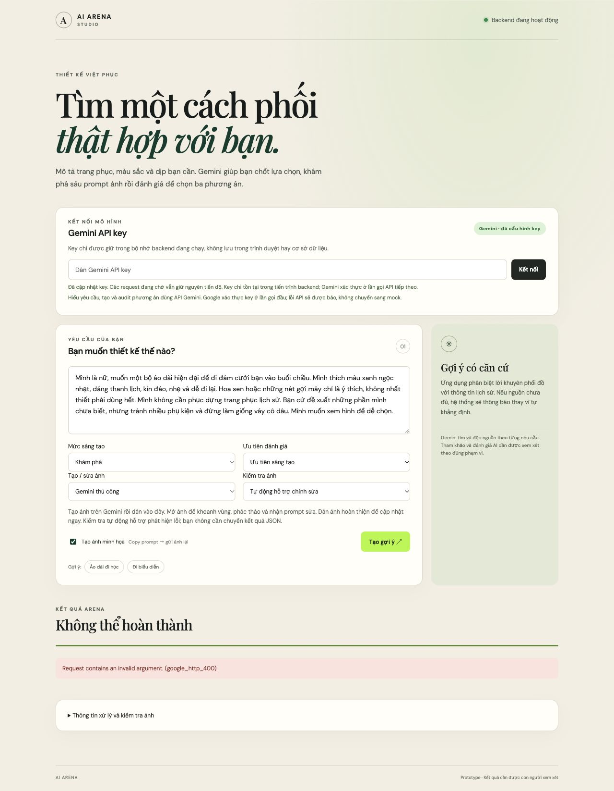
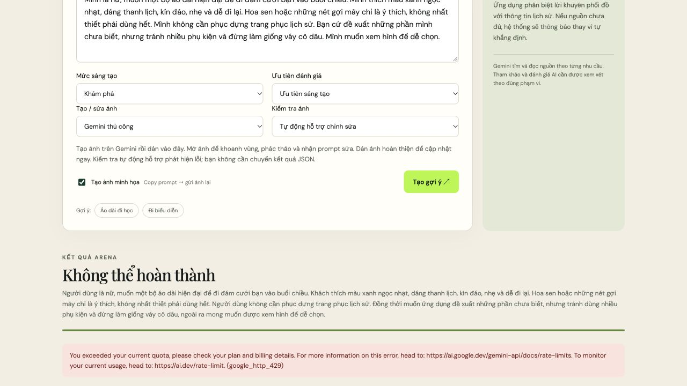

> Phạm vi tài liệu: hồ sơ theo thời điểm, không phải hướng dẫn runtime hiện hành. Các số đo/kết luận bên dưới thuộc phiên hoặc kế hoạch được mô tả; cơ chế có thể đã thay đổi. Xem [README hiện hành](../../README.md) và đối chiếu mã/cấu hình trước khi áp dụng.

# Phiên thật và chỉnh sửa trải nghiệm Việt phục v2

**Kết quả: chưa hoàn tất phiên tạo/chỉnh ảnh.** Đã thử bằng Gemini API thật, sửa điểm chặn schema và chạy được VP01. Phiên dừng ở VP02 khi tìm nguồn vì Google trả 429. Chưa có checklist, ba thẻ hay prompt thứ ba để chọn. Không thay kết quả bằng fixture, không tạo ảnh từ một prompt tự dựng để gọi đó là phiên thành công.

Đánh giá dưới đây dùng góc nhìn một người dùng nữ không chuyên về kỹ thuật, không biết prompt. Đây là nhận xét cảm quan của người thực hiện thao tác với persona đó, chưa phải nghiên cứu với người dùng nữ thực tế. Phần đã thao tác thật và phần chỉ đọc mã được ghi riêng.

## Nhu cầu dùng trong phiên

> Mình là nữ, muốn một bộ áo dài hiện đại để đi đám cưới bạn vào buổi chiều. Mình thích màu xanh ngọc nhạt, dáng thanh lịch, kín đáo, nhẹ và dễ đi lại. Hoa sen hoặc những nét gợi mây chỉ là ý thích, không nhất thiết phải dùng hết. Mình không cần phục dựng trang phục lịch sử. Bạn cứ đề xuất những phần mình chưa biết, nhưng tránh nhiều phụ kiện và đừng làm giống váy cô dâu. Mình muốn xem hình để dễ chọn.

Giữ mặc định khám phá, trọng số ưu tiên sáng tạo, ảnh Gemini thủ công và kiểm tra ảnh hỗ trợ tự động. Đích thao tác được yêu cầu là phương án thứ ba, sau đó sửa ảnh cơ bản; đích này chưa đạt.

Chạy trên máy chủ thử riêng ở cổng 8799, dữ liệu mới `backend/.data/viet-phuc-v2-live-ux-20261003`, evidence mới `backend/evidence/viet-phuc-v2-live-ux-20261003`. Không dừng máy chủ của người dùng ở 8787, không sửa dữ liệu/hình ảnh/evidence cũ. API key nhập vào trường mật khẩu, không lưu trong tệp hay báo cáo. Tiến trình thử đã dừng để giải phóng key khỏi bộ nhớ.

## Những gì thực sự xảy ra

| Lượt ứng dụng | Kết quả thật | Điểm dừng |
|---|---|---|
| `18921acc-d526-4829-baee-7dec7e012e46` | 1 HTTP attempt, Google 400; 0,792 giây xử lý | VP01; chưa có clean/checklist |
| `f1bdf342-27ab-4f64-9e35-edbef4d5b6b2` | Đã bỏ minLength/maxLength/uniqueItems khỏi schema gửi Google; vẫn 400; 1 attempt, 0,797 giây | VP01; array bounds còn trong schema |
| `af4df8b8-d374-45bc-ae57-f0e4124e3bd0` | VP01 thành công sau sửa bản schema gửi Google; VP02 và một retry đều 429; 3 attempts, 11,946 giây | VP02, trước bảng lựa chọn |

VP01 cuối mất 10,795 giây, giữ được người mặc nữ, áo dài hiện đại, dịp đám cưới chiều, màu xanh ngọc, sen/mây tùy chọn, giao AI đề xuất và tránh giống cô dâu/nhiều phụ kiện trong văn bản clean. Không coi việc JSON hợp lệ là chứng minh hiểu đúng hoàn toàn: Gemini đã phân loại “dáng thanh lịch, kín đáo, nhẹ và dễ đi lại” là `must`, trong khi câu gốc đặt nó sau “Mình thích”. Đây là rủi ro nâng sở thích thành điều bắt buộc cần đối chiếu ở VP02; VP02 chưa chạy thành công nên chưa biết có được sửa hay không. “Không cần phục dựng” cũng cần đọc đúng phạm vi, không suy thành một lệnh cấm chung về lịch sử.

Control request văn bản và JSON nhỏ đều 200. Một diagnostic dùng cùng VP01, bỏ array bounds, trả 200. Điều này thu hẹp lỗi 400 vào schema có array bounds lồng nhau trong trường hợp thử; Google chỉ trả thông báo chung, chưa xác nhận chính xác giới hạn nội bộ nào bị vượt. Bản đầy đủ vẫn được validator backend kiểm tra.

Diagnostic replay VP02 giữ response lỗi đầy đủ: `RESOURCE_EXHAUSTED`, không có con số quota hoặc RetryInfo. [Bảng giá Google](https://ai.google.dev/gemini-api/docs/pricing) ghi Search Grounding của Gemini 3.5 Flash-Lite không có ở free tier. Đây là lý do khả dĩ phù hợp với triệu chứng; chưa kiểm tra billing/tier của project nên không khẳng định project chắc chắn thuộc free tier hay quota chắc chắn bằng 0.

Thử đúng một request ngắn Search với `gemini-2.5-flash` để tìm đường có quyền sử dụng: Google trả 404, model không được cấp cho người dùng mới. [Tài liệu model 2.5](https://ai.google.dev/gemini-api/docs/models/gemini-2.5-flash) cũng nêu giới hạn truy cập này. Đây chỉ là diagnostic, không đổi model mặc định của sản phẩm. VP02R vẫn cần quyền tìm nguồn nên không chữa được một quyền/quota Grounding chưa khả dụng bằng việc tách schema.

## Đánh giá cảm quan theo bốn câu hỏi

| Câu hỏi | Điều đã quan sát thật | Cảm nhận và tác động |
|---|---|---|
| Nội dung thừa? | Khối API key lớn, hai bộ lựa chọn sáng tạo/ưu tiên điểm, chế độ API/audit JSON, checkbox ảnh và hướng dẫn kỹ thuật xuất hiện trước ô gửi yêu cầu. Khi lỗi, nguyên đoạn clean dài được lặp gần nội dung đã nhập. | Tôi chỉ muốn biết bộ đồ trông thế nào. Tôi phải đọc và đoán nhiều thiết lập trước khi bắt đầu; “audit”, “JSON”, “backend” không giúp chọn đồ. Hai tùy chọn sáng tạo dễ bị hiểu là cùng một việc. |
| Nội dung thiếu? | Không giải thích rõ đăng nhập Gemini khác API key; lỗi không nêu ứng dụng dừng ở bước nào, phải đổi nhu cầu, đổi key hay chờ. Không có nút hành động cạnh lỗi. | Tôi không biết mình làm sai ở đâu, càng không biết làm gì tiếp. Khi đã đăng nhập Gemini, tôi có thể nghĩ ứng dụng cũng đã kết nối đầy đủ. |
| Có lỗi? | Google 400 ở VP01 hai lần, 429 ở VP02 hai lần. Một retry quota được gửi ngay và còn nối lời “sửa hợp đồng” dù đây là lỗi dịch vụ. | Đây là lỗi cấu hình/quyền dịch vụ, không phải nhu cầu áo dài của người dùng. Thông báo tiếng Anh làm nó giống lỗi do tôi nhập sai. |
| Có dừng và báo rõ? | Có dừng, hiện “Không thể hoàn thành” và lỗi tiếng Anh. Thanh tiến độ xanh vẫn chạy tới trạng thái đầy vì mọi terminal đều được đánh dấu done. | Biết đã thất bại, nhưng không biết bước nào hoặc bước tiếp. Thanh xanh tạo tín hiệu hoàn thành mâu thuẫn với lỗi đỏ. Chưa đạt tiêu chí thông báo dừng rõ ràng. |

Một lỗi kết nối local tạm thời khi người thực hiện restart máy chủ đã tạo trang “refused to connect”; mở tab thử mới sau khi server sẵn sàng xử lý được. Không coi sự cố restart do người thực hiện là lỗi nghiệp vụ của người dùng. Việc locator tự động khớp hai nhãn API key cũng là vấn đề điều khiển công cụ, không đưa vào danh sách lỗi sản phẩm.

## Phần chỉ đối chiếu mã, chưa thao tác thật

- **Nhận prompt và chọn ảnh là hai thao tác tách rời:** mã trước sửa chỉ copy khi bấm Nhận prompt. Nếu người dùng copy phương án 3 nhưng không bấm Chọn phương án này, ô nhận ảnh vẫn có thể ở phương án 1. Đây là rủi ro thấy trong mã, chưa phải lỗi đã tái hiện bằng ảnh thật trong phiên này.
- **Prompt dài tự mở sau copy:** người dùng không cần đọc văn bản giao việc dài chỉ để sang Gemini; giữ Xem prompt riêng phù hợp hơn.
- **Thẻ có mô tả và nhận xét AI lặp nội dung:** giữ ba phần chuyên môn, đưa nhận xét chi tiết vào phần mở rộng giúp so sánh nhanh. Chưa thấy ba thẻ từ model thật để đánh giá độ dài thực tế.
- **Hướng dẫn tạo ảnh thu gọn:** cần nói rõ paste đoạn hướng dẫn vào Gemini, cách xử lý khi Gemini trả chữ, tải/copy ảnh về, chọn đúng phương án và bấm Gửi ảnh. Chưa kiểm chứng tên công cụ, khả năng tạo ảnh, clipboard hay download trong giao diện Gemini của tài khoản này.
- **Checklist:** mã có chọn một/nhiều/custom/AI, nhưng thiếu chỉ dẫn số lựa chọn và thông báo chỉ rõ nhóm còn thiếu trước khi submit. Chưa kiểm chứng các nhóm/nguồn Gemini thực tế tạo ra.

Không chấm trải nghiệm khoanh/phác, hai ảnh, paste ảnh hoàn thiện hoặc độ đúng văn hóa từ fixture. Chưa có ảnh để nhận xét chất lượng hay kết quả sửa cơ bản.

## Các sửa đổi sau đánh giá

1. Giới thiệu bằng lời thường và ba bước thao tác. Thu gọn API key sau kết nối, phân biệt API key với đăng nhập Gemini, đưa thiết lập kỹ thuật vào Cài đặt nâng cao. Không chọn ngầm bất kỳ câu trả lời checklist nào.
2. Lỗi dịch vụ hiển thị giải thích tiếng Việt, chi tiết kỹ thuật mở riêng. Thêm bước dừng, đường kiểm tra quota, mở phần đổi key và nút Thử lại yêu cầu. Mất kết nối khi đọc job có Tải lại tiến độ để tiếp tục phiên cũ.
3. Chỉ trạng thái hoàn tất hiển thị tiến độ thành công; trạng thái dừng dùng màu lỗi. Tóm tắt kết quả nêu việc người dùng cần làm, không lặp clean dài; clean/raw vẫn nằm trong checklist và report.
4. Mỗi lần gửi mới có idempotency key riêng, giữ cùng key khi response create bị mất trên cùng trang. Có khóa gửi trong lúc đang submit. Điều này tránh nút thử lại bị backend đưa trở lại đúng job failed do fingerprint cũ; không tự reset ngân sách một job đang chạy.
5. Nhận prompt copy nguyên văn trước, sau đó chọn candidate qua endpoint `/image-candidate` khi chưa nhận ảnh. Nếu việc chọn lỗi, báo rõ prompt đã copy nhưng chưa gắn ô nhận ảnh. Không đổi prompt/hash sau audit. Xem prompt vẫn là thao tác riêng; fallback clipboard mở văn bản để copy thủ công.
6. Giữ ba phần chuyên môn trên thẻ, thu gọn nhận xét AI chi tiết. Hướng dẫn tạo/nhận ảnh mở sẵn. Checklist chỉ rõ số ý và tên nhóm cần bổ sung trước khi gửi, giữ backend validator làm kiểm tra cuối.
7. Provider gửi schema tương thích Google, ghi các constraints bị tách trong description; validator giữ hợp đồng đầy đủ. HTTP error evidence mới giữ status/details đã loại key. 429 không có RetryInfo dừng ngay; có RetryInfo thì chờ trong design deadline trước tối đa một retry, kiểm tra hủy/revision khi chờ. Lỗi dịch vụ không bị coi là lỗi nội dung để nối hướng dẫn “sửa hợp đồng”.

Đối chiếu [structured output](https://ai.google.dev/gemini-api/docs/structured-output) và [REST responseFormat](https://ai.google.dev/api/generate-content) trước sửa wire schema. Giữ model mặc định `gemini-3.5-flash-lite`, temperature 1,0 cho VP tasks trên Gemini 3; không thay trọng số sáng tạo bằng temperature. Giữ cấu hình sáu prompt, 2 × 3, ngưỡng 70, design 26/240 và media 13/90. Dữ liệu hiện có chưa đủ để điều chỉnh những con số này có căn cứ.

Không sửa `frontend/image-editor.js` hoặc `arena-kit/image-edit-template.txt`. Hai tệp giống HEAD từng byte, SHA-256 trong [static-checks.json](assets/live-ux-20261003/static-checks.json). Điểm nối mới chỉ dùng endpoint chọn candidate hiện có; packet khoanh/phác, thứ tự hai ảnh và endpoint nhận ảnh sửa giữ nguyên. Sự giống byte chứng minh không đổi hai tệp, không thay thế kiểm chứng hành vi ảnh thật.

## API accounting và giới hạn kiểm tra

| Nhóm | Attempts | Kết quả |
|---|---:|---|
| Ba lượt ứng dụng | 5 | 2 × 400; VP01 200; 2 × VP02 429 |
| Diagnostic văn bản/JSON/schema | 4 | 3 × 200; 1 lỗi TLS local trước response Google |
| Diagnostic chi tiết quota VP02 | 1 | 429 |
| Diagnostic quyền model 2.5/Search | 1 | 404 |
| **Tổng** | **11** | **10 HTTP responses Google, 1 lỗi transport local** |

Google báo tổng **10.536 tokens** cho bốn response 200. Calls lỗi không có usage; không giả định chi phí của chúng bằng 0. Không có query Search được báo trong metadata, nhưng điều đó không xác nhận cách Google tính phí lỗi. **0 media API calls, 0 prompt gửi tạo ảnh trên website Gemini, 0 ảnh tải về, 0 ảnh sửa.** [Ledger đầy đủ](../../backend/evidence/viet-phuc-v2-live-ux-20261003/live-accounting.json) phân tách ứng dụng/diagnostic; các diagnostic không thuộc counter job nên không bị giấu trong báo cáo 3 calls của phiên cuối. Trần thử tổng dự kiến 30; dừng ở 11, không tiêu nốt trần để lặp quota.

Trước giai đoạn chỉnh UX, đã chạy một unit test biến đổi wire schema (không mạng), đạt. **Sau chỉnh UX chỉ kiểm tra tĩnh theo yêu cầu:** `node --check` cho app và hai file test frontend; `compileall`/AST cho Python; đọc JSON; kiểm tra thẻ HTML đóng/mở, ID/label; `git diff --check`; so byte/hash hai tệp bảo vệ và rà credential trong evidence mới. Các kiểm tra này đạt. Checker HTML ban đầu chưa xử lý self-closing void tags; sửa checker rồi chạy lại đạt, không phải lỗi HTML sản phẩm.

Thêm test nguồn cho wire schema/local constraints, quota không có retry hint, thông báo lỗi, lựa chọn candidate thứ ba, không tự mở prompt và nhóm checklist thiếu lựa chọn. **Không chạy lại các test hành vi hoặc một phiên giả định sau chỉnh UX.** Không lấy kết quả 148 test fixture/hồi quy trước đó làm kết quả test mới của các thay đổi này. [Báo cáo fixture trước phiên thật](IMPLEMENTATION_REPORT.md) vẫn là mốc riêng, giữ con số 0 API thật của giai đoạn đó.

## Còn thiếu để nghiệm thu phiên hoàn chỉnh

Cần API project/key có quyền và quota Search Grounding cho model đang dùng. Key hiện tại đã dùng được với văn bản; lỗi không đủ dữ liệu để xác định billing/tier cụ thể. Chưa nghiệm thu VP02/VP02R, checklist/lựa chọn thật, VP03–VP08, top 3, copy/nhận ảnh của phương án 3, tạo và tải ảnh Gemini, chỉnh cơ bản bằng hai ảnh, paste ảnh hoàn thiện hoặc audit ảnh P06. Nội dung/nguồn văn hóa vẫn chưa được đối chiếu thực tế.

Các sửa UX và retry sau đánh giá mới có bằng chứng kiểm tra tĩnh, chưa có bằng chứng end-to-end. Không tự bật thanh toán, đổi quyền tài khoản, triển khai hay công bố ra ngoài. Máy chủ 8787 đang chạy cần được người vận hành khởi động lại khi muốn nạp mã Python đã sửa; phiên thử riêng đã dừng.
